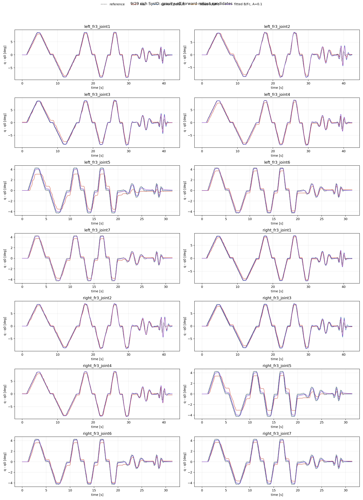

# 9/29 gravity-off MuJoCo forward-rollout validation

This is a closed-loop position-response replay, not an inverse-dynamics torque
fit. Every candidate uses the logged real q0 and q0-relative reference, 1 ms
MuJoCo stepping, Kp=80, Kd=4, the 87/12 Nm actuator limits, and the
1000 Nm/s effort rate limit. Robot gravity and contacts are disabled to retain
the existing Isaac/FCI control abstraction.

## Mean active-joint position metrics

| Candidate | zero-lag RMSE [deg] | lag-compensated RMSE [deg] | mean sim/real p2p ratio |
|---|---:|---:|---:|
| current default | 0.504 | 0.425 | 1.113 |
| fitted A/B/Fc | 0.392 | 0.325 | 1.092 |
| fitted B/Fc, A=0.1 | 0.395 | 0.343 | 1.095 |

## Fit-held-out phase mean active-joint position metrics

Only v0.150 cruise and f1.00 sine phases, excluded from the inverse-dynamics fit, are used below.

| Candidate | zero-lag RMSE [deg] | lag-compensated RMSE [deg] | mean sim/real p2p ratio |
|---|---:|---:|---:|
| current default | 0.463 | 0.414 | 0.964 |
| fitted A/B/Fc | 0.349 | 0.307 | 0.965 |
| fitted B/Fc, A=0.1 | 0.339 | 0.310 | 0.970 |

## Scope and decision rule

The fitted inverse-dynamics parameters are candidates, not accepted physical
values. In particular the fit's armatures reach their non-negative lower
bound. Therefore the conservative B/Fc-only candidate is reported alongside
the literal fit. Do not use the candidate in Isaac Lab or RL until it improves
position-response metrics **and** the default replay fidelity is adequate.

Real raw `tau_J` is intentionally not compared with gravity-off simulated
actuator effort here. Continue using the gravity-on inverse-dynamics held-out
torque RMSE for the torque-model check.

