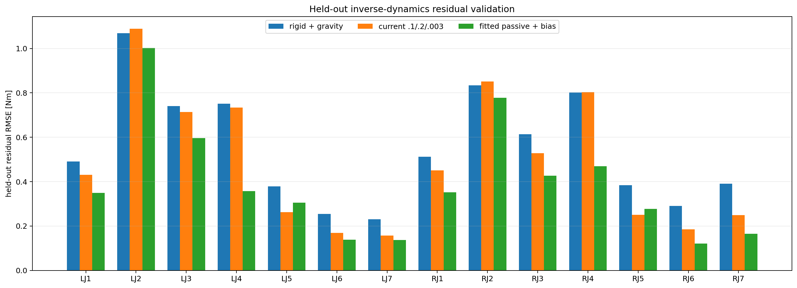
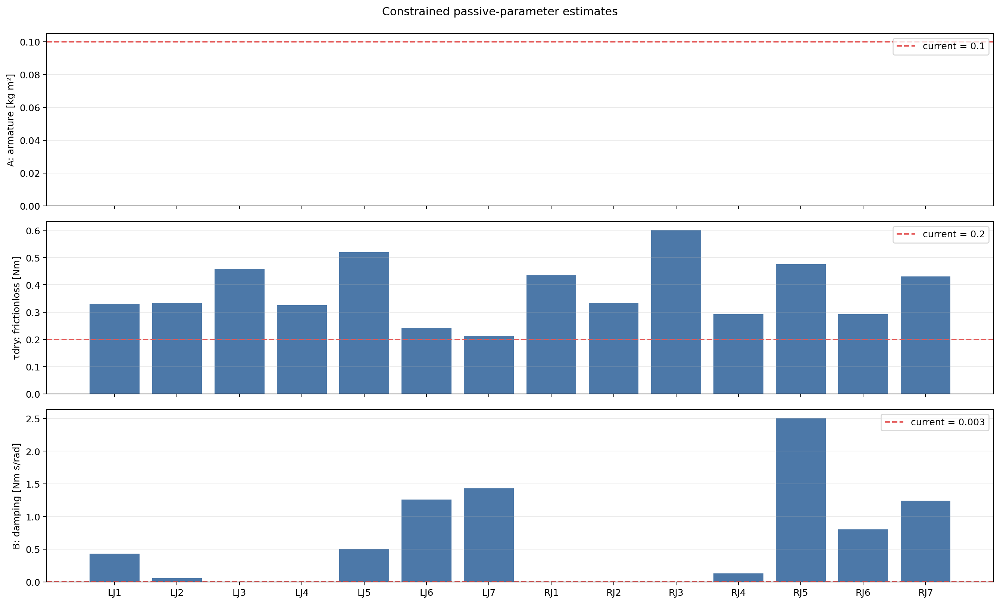

# Dual-FR3 passive-dynamics fit

## Method

For each active joint, the gravity-on, contact-disabled MuJoCo rigid-body
inverse dynamics is subtracted from real measured torque:

$$r = \tau_{meas}-[M(q)\ddot q+C(q,\dot q)\dot q+g(q)].$$

The constrained fit is:

$$r_i=A_i\ddot q_i+\tau_{dry,i}\operatorname{sgn}(\dot q_i)+B_i\dot q_i+b_i,$$

with $A_i,\tau_{dry,i},B_i\ge0$.  The diagnostic bias $b_i$ is not
an MJCF parameter and is not applied to MuJoCo.

- Train phases: cruise at 0.05/0.10 rad/s and sine at 0.50 Hz.
- Held-out phases: cruise at 0.15 rad/s and sine at 1.00 Hz.
- Short phase-edge regions and samples below 0.015 rad/s are excluded.
- This is free-motion inverse-dynamics replay; it is not forward-rollout validation.

## Result

Held-out mean RMSE: rigid+gravity 0.5528 Nm, current defaults 0.4909 Nm, fitted residual model 0.3909 Nm.





## Per-joint result

| Joint | A [kg m²] | τdry [Nm] | B [Nm s/rad] | Bias [Nm] | Held RBD | Held current | Held fitted |
|---|---:|---:|---:|---:|---:|---:|---:|
| left_fr3_joint1 | 0.00000 | 0.3305 | 0.4309 | +0.0026 | 0.4904 | 0.4310 | 0.3490 |
| left_fr3_joint2 | 0.00000 | 0.3325 | 0.0526 | -0.2577 | 1.0686 | 1.0894 | 1.0017 |
| left_fr3_joint3 | 0.00000 | 0.4587 | 0.0000 | -0.2348 | 0.7407 | 0.7131 | 0.5966 |
| left_fr3_joint4 | 0.00000 | 0.3256 | 0.0000 | +0.6286 | 0.7504 | 0.7336 | 0.3578 |
| left_fr3_joint5 | 0.00000 | 0.5197 | 0.5006 | +0.0298 | 0.3781 | 0.2617 | 0.3048 |
| left_fr3_joint6 | 0.00000 | 0.2423 | 1.2604 | +0.0441 | 0.2540 | 0.1687 | 0.1377 |
| left_fr3_joint7 | 0.00000 | 0.2136 | 1.4299 | +0.0319 | 0.2306 | 0.1575 | 0.1373 |
| right_fr3_joint1 | 0.00000 | 0.4348 | 0.0000 | +0.0948 | 0.5126 | 0.4503 | 0.3521 |
| right_fr3_joint2 | 0.00000 | 0.3324 | 0.0000 | +0.1739 | 0.8339 | 0.8517 | 0.7777 |
| right_fr3_joint3 | 0.00000 | 0.6018 | 0.0000 | +0.0083 | 0.6139 | 0.5284 | 0.4260 |
| right_fr3_joint4 | 0.00000 | 0.2924 | 0.1259 | +0.6447 | 0.8018 | 0.8036 | 0.4691 |
| right_fr3_joint5 | 0.00000 | 0.4763 | 2.5119 | -0.0966 | 0.3838 | 0.2501 | 0.2777 |
| right_fr3_joint6 | 0.00000 | 0.2930 | 0.8050 | +0.0820 | 0.2906 | 0.1844 | 0.1206 |
| right_fr3_joint7 | 0.00000 | 0.4301 | 1.2457 | -0.0159 | 0.3905 | 0.2484 | 0.1647 |

## Interpretation boundary

Do **not** copy these values into the MJCF automatically.  A parameter is a
candidate only if its held-out error improves and its value is stable under a
future split/cutoff sensitivity check.  The next required validation is a
forward rollout with the same PD/reference and a separate held-out trajectory.

## Reproduction

```bash
python scripts/tools/fit_sysid_passive_parameters.py \
  --mjcf /tmp/dual_fr3_plate_260929.xml \
  --csv 'data/sysid_raw/real/*.csv' \
  --output-dir data/sysid_passive_fit_260929
```
