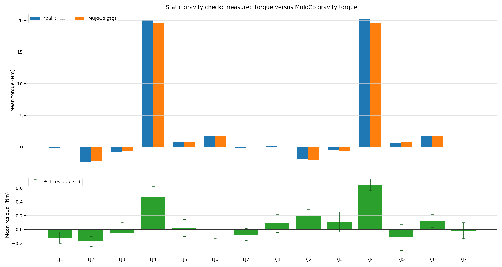
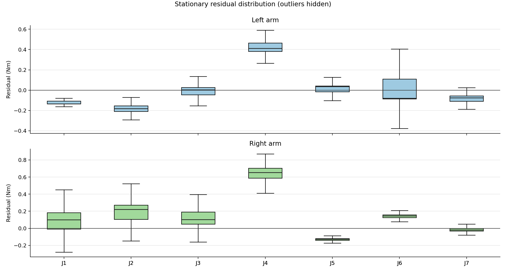
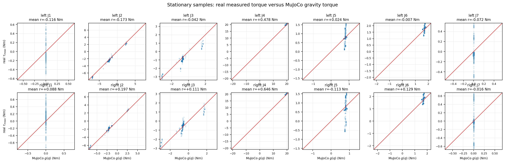

# Dual-FR3 static gravity validation

## Result

- Stationary samples: **215,901**
- Velocity criterion: every arm joint satisfies `abs(qd) < 0.010 rad/s`
- Largest absolute mean residual: **right_fr3_joint4 = 0.646 Nm**
- MJCF: `/tmp/dual_fr3_plate_260929.xml`

## Method

For each stationary real-log row, MuJoCo runs `mj_inverse` with the same 14 measured joint positions and zero joint velocity/acceleration. Gravity is set to -9.81 m/s². Contact is disabled, and `damping`, `frictionloss`, and `armature` are set to zero, so the comparison is:

$$\tau_{meas} \stackrel{?}{\approx} g_{MJ}(q), \quad r=\tau_{meas}-g_{MJ}(q).$$

This validates the payload/gravity/joint-mapping part of the model. It does **not** identify friction, damping, armature, controller delay, or contact dynamics. Those remain in the residual and are handled in the next free-motion SysID stage.

## Plots







## Joint summary

| Joint | Samples | Mean measured torque (Nm) | Mean MuJoCo gravity (Nm) | Mean residual (Nm) | Residual std (Nm) | 5–95% residual (Nm) |
|---|---:|---:|---:|---:|---:|---:|
| left_fr3_joint1 | 215,901 | -0.116 | 0.000 | -0.116 | 0.084 | [-0.162, -0.051] |
| left_fr3_joint2 | 215,901 | -2.318 | -2.145 | -0.173 | 0.072 | [-0.237, -0.065] |
| left_fr3_joint3 | 215,901 | -0.736 | -0.694 | -0.042 | 0.148 | [-0.301, 0.062] |
| left_fr3_joint4 | 215,901 | 20.063 | 19.585 | +0.478 | 0.151 | [0.354, 0.788] |
| left_fr3_joint5 | 215,901 | 0.813 | 0.790 | +0.024 | 0.123 | [-0.039, 0.055] |
| left_fr3_joint6 | 215,901 | 1.687 | 1.694 | -0.007 | 0.119 | [-0.097, 0.153] |
| left_fr3_joint7 | 215,901 | -0.072 | 0.000 | -0.072 | 0.086 | [-0.129, -0.017] |
| right_fr3_joint1 | 215,901 | 0.088 | 0.000 | +0.088 | 0.129 | [-0.060, 0.234] |
| right_fr3_joint2 | 215,901 | -1.909 | -2.105 | +0.197 | 0.099 | [0.048, 0.301] |
| right_fr3_joint3 | 215,901 | -0.497 | -0.608 | +0.111 | 0.144 | [-0.005, 0.265] |
| right_fr3_joint4 | 215,901 | 20.222 | 19.575 | +0.646 | 0.084 | [0.516, 0.761] |
| right_fr3_joint5 | 215,901 | 0.683 | 0.796 | -0.113 | 0.191 | [-0.183, 0.006] |
| right_fr3_joint6 | 215,901 | 1.826 | 1.697 | +0.129 | 0.095 | [-0.042, 0.174] |
| right_fr3_joint7 | 215,901 | -0.016 | 0.000 | -0.016 | 0.117 | [-0.058, 0.021] |

## Reproduction

```bash
python scripts/tools/report_sysid_static_gravity.py \
  --mjcf /tmp/dual_fr3_plate_260929.xml \
  --csv 'data/sysid_raw/real/*.csv' \
  --output-dir /home/dyros/etri_ws/src/fr3_husky_etri/data/sysid_validation_260929
```
