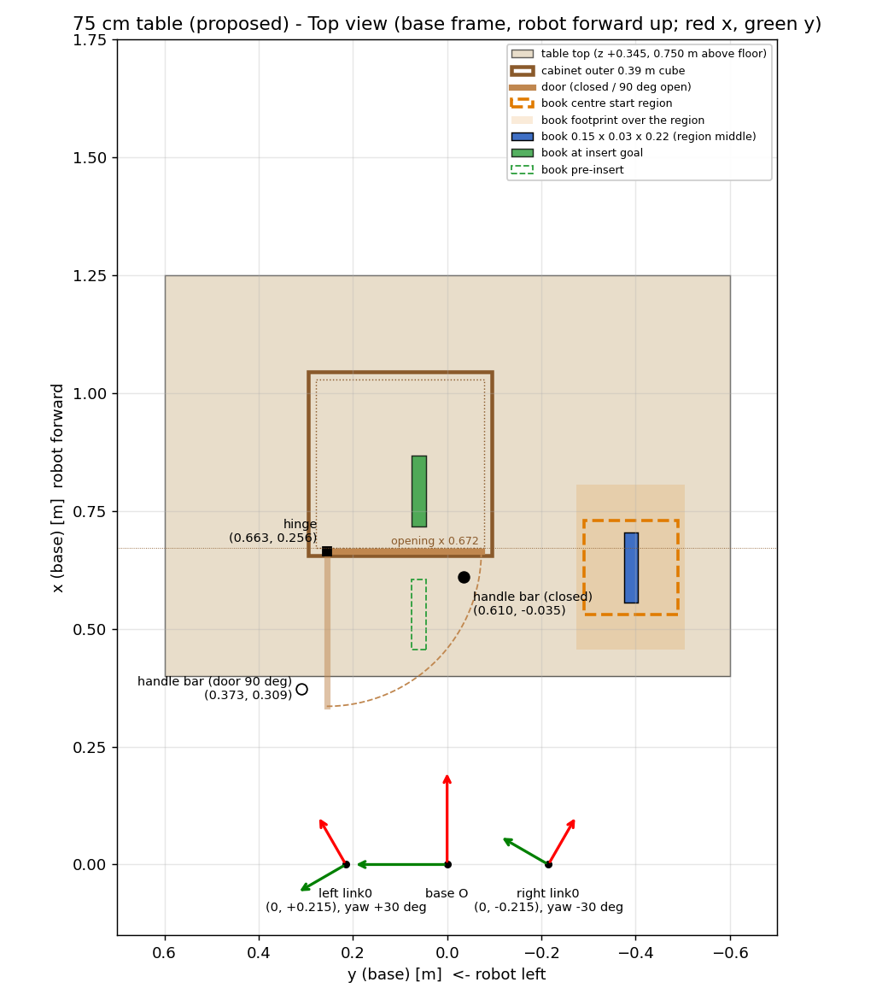
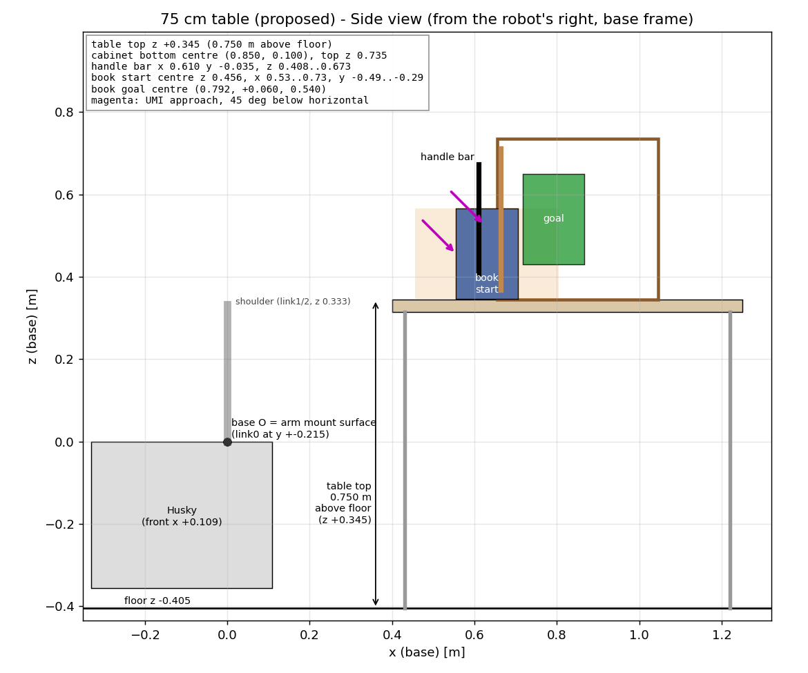
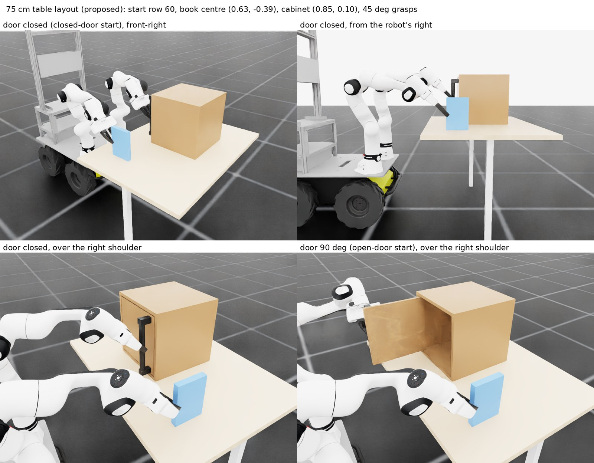
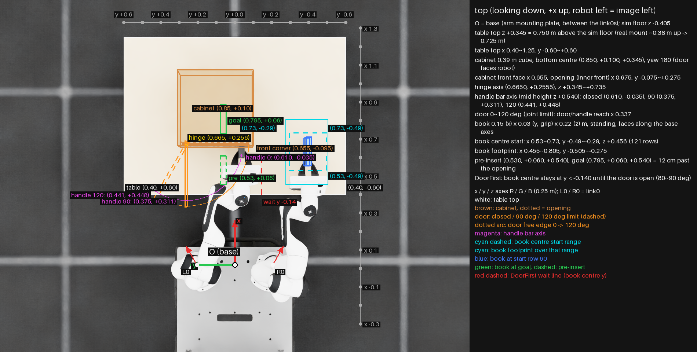
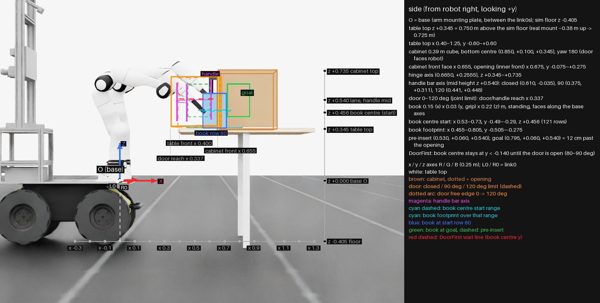
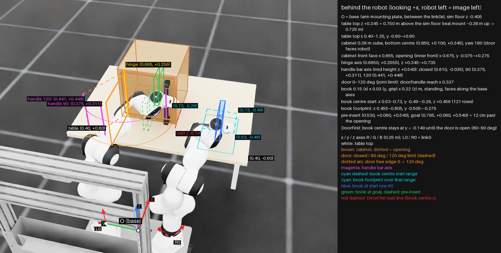
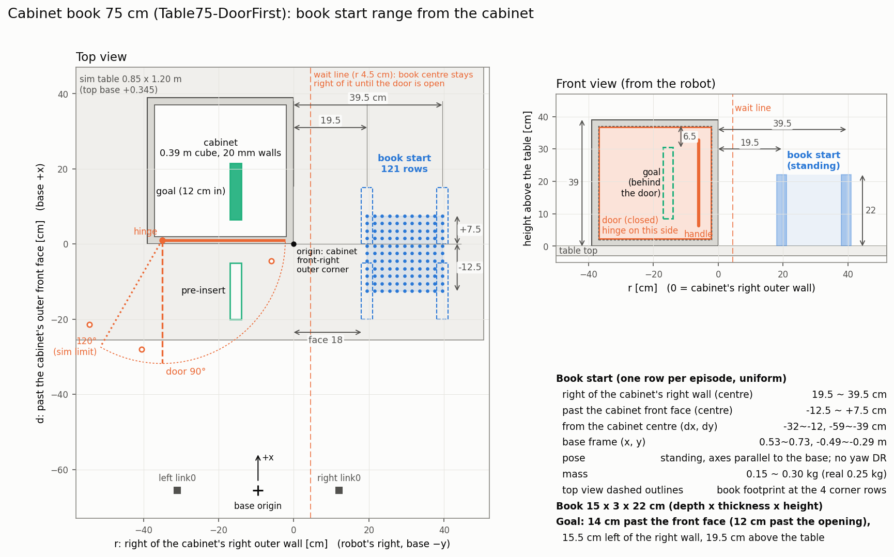

# dual FR3 캐비닛 책 넣기: 75 cm 책상 배치 (제안, 2026-11-06)

실험실 책상은 최소 높이가 70 cm라, 지금 학습한 45 cm 배치([dual_fr3_cabinet_book_real_setup.md](dual_fr3_cabinet_book_real_setup.md))를 그대로 쓸 수 없다. 처음 배치를 정할 때 쓴 solver(`dual_fr3_lab/scripts/tools/solve_cabinet_book_start.py`)로 75 cm 배치를 다시 찾았다. solver가 확인하는 것:
- 왼손: 손잡이를 잡고 문을 0 → 90° 연다.
- 오른손: 책을 들어 수납장 앞으로 옮기고 넣는다(규칙 기반 경로).
- 경로 내내 IK가 수렴하고, 팔끼리·책상과 부딪치지 않고, 관절 한계 여유가 남아야 한다.
- 수납장과 책은 solver scene에 없어서, 책·손과 수납장 사이 접촉은 보지 않는다.

**상태 (2026-11-07)**
- dual_fr3_lab에 75 cm task가 있다. rule-based로 121개 행 모두 성공했다.
- **75 cm 정책: DoorFirst 2998** (`fr3_husky_nn_policy/models/cabinet_book_insert_75cm_door_first_model_2998.npz`, 11-07). sim 121/121, 책이 입구에 닿을 때 문 중앙 97°(최소 92°). 실행 순서는 [dual_fr3_cabinet_book_experi_step.md](dual_fr3_cabinet_book_experi_step.md)의 "75 cm 책상: DoorFirst 2998" 절.
  - `Isaac-Cabinet-BookInsert-DualFR3-UMI-Table75{,-OpenDoor}-v0` (11-06): v2 보상.
  - `Isaac-Cabinet-BookInsert-DualFR3-UMI-Table75-DoorFirst-v0` (11-07): v2 보상 + DoorFirst(문을 다 연 뒤 책). 책 중심이 문 80~90°까지 y −0.14 오른쪽에서 기다린다. rule-based 121/121, 접촉 0, 손잡이 최대 14 N.
- 75 cm task의 책 무게 DR은 0.15~0.30 kg이다(실물 책 0.25 kg). 실물 책상 윗면을 팔 장착면에서 재니 +0.345 m로 sim과 같아서 책상 높이는 랜덤화하지 않는다.
- 지금 있는 정책(open-door 2499, closed-door 7498, v1 14999)과 45 cm DoorFirst는 45 cm 배치 전용이다. 75 cm 책상에서는 쓰지 않는다.

## 결론: 책상을 0.30 m 올리고 수납장을 0.10 m 당긴다

| | 45 cm (지금 학습) | **75 cm (제안)** |
|---|---|---|
| 책상 윗면 (base z) | +0.045 | **+0.345** |
| 책상 윗면 (바닥에서, sim) | 0.450 m | **0.750 m** |
| 수납장 밑면 중심 (base x, y) | (0.950, 0.100) | **(0.850, 0.100)** |
| 손 접근 각도 (왼손·오른손) | 45° 아래로 | 45° 아래로 (같음) |
| 책 시작 범위 (중심 x, y) | x 0.53~0.73, y −0.49~−0.29 | 같음 |
| 책 시작 높이 (중심 z) | 0.156 | 0.456 |

- 손 잡는 방식이 같아서, FK 노드의 손-책, 손-손잡이 변환은 그대로 쓸 수 있다. 바뀌는 것은 경첩 위치와 문 닫힘 기준점뿐이다(아래 표).
- 바닥 높이는 sim 기준이다(장착면이 바닥에서 0.405 m). **실물에서 맞출 것은 "책상 윗면 = 팔 장착면 + 0.345 m"이다.**
  - 실물 장착면은 바닥에서 약 0.38 m다(2026-11-06 측정, 타이어 눌림). 그러면 책상은 실물 바닥에서 **0.725 m**로 맞춘다.
  - 책상을 0.75 m로 쓰려면 학습 쪽 책상 윗면을 base +0.370으로 바꾼다(solver `--table_dz 0.325`).
  - 짐이나 타이어 공기압에 따라 장착면 높이가 바뀔 수 있으니, 학습 때 책상·수납장 높이를 ±2~3 cm 랜덤화하는 것을 권한다.

## solver 결과 (121개 책 시작 위치)

| 배치 | 통과 | 왼팔 경로 여유 | 오른팔 경로 여유 (최소 / 평균) |
|---|---|---|---|
| 45 cm (지금 학습한 표) | 121/121 | 0.30 rad | 0.13 / 0.39 rad |
| 75 cm, 수납장 그대로 (0.95, 0.10), 접근 20° | 121/121 | 0.28 rad | 0.11 / 0.33 rad |
| **75 cm, 수납장 (0.85, 0.10), 접근 45°** | **121/121** | **0.57 rad** | **0.32 / 0.50 rad** |

- 경로 여유: 문 열기, 책 옮기기 경로 내내 관절이 한계에서 떨어진 최소 거리.
- 처음에는 수납장 위치 x 0.85/0.95/1.05, y 0.0/0.10/0.20와 접근 각도 0/20/45°를 모두 훑었다(가운데 책 시작 위치 하나).
  - 수평 접근(0°)은 수납장 y 0.0이나 x 1.05에서 실패하고, 통과한 곳도 여유가 0.2 rad 아래다.
  - x 1.05는 대부분 실패하고, 통과해도 오른팔이 넣기 끝에서 특이점에 가깝다(sigma_min 0.03~0.08).
  - 수납장을 그대로 두는 배치(접근만 20°로)와, 여유가 크고 특이점에서 먼 (0.85, 0.10) 45° 배치로 121개 표를 풀었다.
- 제안 배치는 지금 45 cm 배치보다 두 팔 모두 여유가 크다. 수납장이 높아진 만큼 가까이 당기면 팔을 덜 뻗어도 된다.

## 그림





sim 시작 자세(행 60, 책 중심 (0.63, −0.39)). 위 두 장과 왼쪽 아래는 문 닫힘 시작, 오른쪽 아래는 문 90° 시작이다.



## 작업 공간 그림 (sim 화면 투영, 2026-11-07)

box 배치 문서의 workspace 그림처럼 sim 화면 위에 base 좌표를 투영했다. 로봇은 시작 행 60 자세, 문은 닫힘이다.

```bash
# dual_fr3_lab
python scripts/tools/draw_cabinet_book_workspace.py --viz none \
    --task Isaac-Cabinet-BookInsert-DualFR3-UMI-Table75-DoorFirst-Play-v0 --out_dir docs/figures --prefix cabinet_book_75cm_workspace
```







## 책 시작 범위 (수납장 기준, 2026-11-07)

학습(Table75-OpenDoor, Table75-DoorFirst)에서 에피소드마다 책 시작 위치를 `start_table_75cm.npz`의 121행(11 x 11, 2 cm 간격) 중 하나로 균일하게 뽑는다. 행 사이 연속 노이즈나 yaw DR은 없다. 책은 세워 두고 축은 base와 평행하다(두께 3 cm가 좌우).

| 기준 | 책 중심 범위 |
|---|---|
| 수납장 오른쪽 바깥 벽에서 오른쪽으로 | 19.5 ~ 39.5 cm (책 옆면까지는 18 ~ 38 cm) |
| 수납장 바깥 앞면에서 안쪽(+x)으로 | −12.5 ~ +7.5 cm (앞면보다 12.5 cm 앞 ~ 7.5 cm 뒤) |
| 수납장 중심에서 (dx, dy) | −32 ~ −12, −59 ~ −39 cm |
| base frame (x, y) | 0.53 ~ 0.73, −0.49 ~ −0.29 m |

- 목표는 앞면에서 14 cm 안쪽(입구에서 12 cm), 오른쪽 벽에서 왼쪽으로 15.5 cm, 책상 위 19.5 cm다.
- 대기선(DoorFirst)은 오른쪽 벽에서 오른쪽으로 4.5 cm다. 문이 열리기 전에는 책 중심이 이 선 오른쪽에 있어야 한다. 시작 범위는 모두 그 오른쪽이다.
- sim 책상은 x 0.40 ~ 1.25, y ±0.60(0.85 x 1.20 m)이다. 책 시작 범위가 올라가도록 넓혀 둔 것이고 실물 책상 크기와 다르다.

```bash
# dual_fr3_lab (Isaac Sim 없이 matplotlib만)
python scripts/tools/draw_cabinet_book_start_range.py --out ~/etri_ws/src/fr3_husky_etri/docs/figures/cabinet_book_75cm_book_start_range.png
```



- 위·옆 그림은 멀리서 망원으로 찍어 거의 정투영이다. 눈금(x, y, z)을 깊이와 관계없이 읽어도 된다. 뒤 그림은 원근 그림이라 눈금이 없다.
- 화살표: x 빨강, y 초록, z 파랑, 길이 0.25 m. L0 / R0은 link0 원점이고, 빨간 화살표가 각 link0의 x축이다(yaw ±30°).
- 흰색 사각형은 책상 윗면, 갈색은 수납장(점선은 입구)이다. 노랑 세로선은 경첩 축이다.
- 문은 닫힘(갈색), 90°(주황), sim 관절 한계 120°(주황 점선)로 그렸다. 주황 점선 호는 문 끝이, 자홍 점선 호는 손잡이 막대가 지나가는 길이다.
  - 45 cm DoorFirst 정책(model_4000)은 문을 119°까지 연다. 75 cm도 같은 보상이라 120° 가까이 열 수 있다. **실물 문이 몇 도까지 열리는지 확인이 필요하다.**
  - 120°에서 손잡이 막대 축은 (0.441, +0.448)이다. 문 끝은 90° 근처에서 x 0.337까지 나온다(책상 앞 모서리 x 0.40보다 6 cm 로봇 쪽).
- 손과 수납장 윗판 여유(rule-based, 20 mm 벽): 책을 14 cm(13.6~14.5)까지 넣어도 접촉 0, 15.5 cm(15~17)로 넣으면 121개 중 41개에서 오른손 link7이 수납장에 5 N 넘게 닿는다. 목표 12 cm에서 깊이 여유가 약 2~3 cm다.
- 하늘색 점선은 책 **중심** 시작 범위, 하늘색 실선은 그 범위에서 책 밑면이 차지하는 영역이다. 파랑은 행 60의 책이다. 초록 실선은 목표, 초록 점선은 넣기 직전 위치다.
- 빨간 점선은 DoorFirst 대기선(y −0.14)이다. 책 중심은 문이 80~90° 열릴 때까지 이 선 오른쪽(−y)에 있어야 한다. 책상 앞 모서리부터 수납장 앞면까지 그렸다.

## 좌표 (base = 두 link0 가운데의 팔 장착면, m)

link0 좌표는 각 팔의 link0 좌표계 값이다(왼쪽 link0 (0, +0.215, 0) yaw +30°, 오른쪽 (0, −0.215, 0) yaw −30°). yaw는 그 좌표계에서 본 물체 방향이다.

| 점 | base | 왼쪽 link0 | 오른쪽 link0 |
|---|---|---|---|
| 책상 윗면 중심 | +0.825, +0.000, +0.345 | +0.607, −0.599, +0.345 | +0.607, +0.599, +0.345 |
| 책상 윗면 앞 왼쪽 모서리 | +0.400, +0.600, +0.345 | +0.539, +0.133, +0.345 | −0.061, +0.906, +0.345 |
| 책상 윗면 앞 오른쪽 모서리 | +0.400, −0.600, +0.345 | −0.061, −0.906, +0.345 | +0.539, −0.133, +0.345 |
| 수납장 밑면 중심 | +0.850, +0.100, +0.345 / 180° | +0.679, −0.525, +0.345 / 150° | +0.579, +0.698, +0.345 / 210° |
| 수납장 앞 밑 모서리 (경첩 쪽) | +0.655, +0.295, +0.345 | +0.607, −0.258, +0.345 | +0.312, +0.769, +0.345 |
| 수납장 앞 밑 모서리 (손잡이 쪽) | +0.655, −0.095, +0.345 | +0.412, −0.596, +0.345 | +0.507, +0.431, +0.345 |
| 경첩 축 (가운데 높이) | +0.665, +0.256, +0.540 | +0.596, −0.297, +0.540 | +0.341, +0.740, +0.540 |
| 손잡이 막대 축 중심 (문 닫힘) | +0.610, −0.035, +0.540 | +0.403, −0.521, +0.540 | +0.438, +0.461, +0.540 |
| 손잡이 막대 축 중심 (문 90°) | +0.375, +0.311, +0.540 | +0.373, −0.104, +0.540 | +0.062, +0.643, +0.540 |
| 왼손 TCP (문 닫힘) | +0.624, −0.035, +0.526 | +0.415, −0.529, +0.526 | +0.451, +0.468, +0.526 |
| 책 중심 시작 (범위 가운데) | +0.630, −0.390, +0.456 / 0° | +0.243, −0.839, +0.456 / −30° | +0.633, +0.163, +0.456 / +30° |
| 책 중심 시작 (x 최소, y 최대) | +0.530, −0.290, +0.456 | +0.206, −0.702, +0.456 | +0.496, +0.200, +0.456 |
| 책 중심 시작 (x 최소, y 최소) | +0.530, −0.490, +0.456 | +0.106, −0.875, +0.456 | +0.597, +0.027, +0.456 |
| 책 중심 시작 (x 최대, y 최대) | +0.730, −0.290, +0.456 | +0.380, −0.802, +0.456 | +0.670, +0.300, +0.456 |
| 책 중심 시작 (x 최대, y 최소) | +0.730, −0.490, +0.456 | +0.280, −0.976, +0.456 | +0.770, +0.127, +0.456 |
| 책 중심 넣기 직전 | +0.530, +0.060, +0.540 | +0.382, −0.399, +0.540 | +0.322, +0.503, +0.540 |
| 책 중심 목표 | +0.795, +0.060, +0.540 | +0.611, −0.532, +0.540 | +0.551, +0.636, +0.540 |

- 수납장은 바깥 0.39 m 정육면체, **벽·문 두께 20 mm**(실물 측정 2026-11-07, 처음 모델은 17 mm), 안쪽 0.35 m, 입구(문 안쪽 면) x 0.675다. 문 0.345 m(앞면보다 사방 2.25 cm 작음), 손잡이 위치, 책 크기는 45 cm 배치 문서와 같다.
- 문이 90° 열리면 문 끝이 책상 앞 모서리(x 0.40) 밖 x 0.337까지 나온다. 문은 책상 윗면보다 위에 있어서 걸리지 않는다.
- FK 노드 보정값은 `hinge_position_base: [0.665, 0.2555, 0.54]`, `left_tcp_closed_position_base: [0.6241, -0.035, 0.5259]`가 된다.

### 시작 관절 (행 60, 배치 확인용)

```text
왼팔 (문 닫힘)  -0.4463 -0.1901 -0.4998 -1.8995  0.3425  2.4281  0.1574
왼팔 (문 90°)   -1.4900 -0.9053  1.0040 -1.8295 -0.0507  1.3683  2.1995
오른팔          0.7872 -0.4824 -0.5670 -2.3592 -0.0158  2.6981  0.4468
```

## 남은 일

1. ~~env cfg에 75 cm 배치를 넣는다~~ (11-06 `apply_table75`, 11-07 DoorFirst 조합).
2. ~~solver로 75 cm 시작 표를 쓴다~~ (`assets/cabinet_book/start_table_75cm.npz`).
3. ~~규칙 기반으로 121개 행을 돌려 본다~~ (Table75 121/121 `--ki_cap 0.04`, Table75-DoorFirst 121/121, 접촉 0).
4. ~~학습한다: Table75-DoorFirst~~ (11-07: Table75-OpenDoor 1000 iteration 뒤 DoorFirst로 이어서 2998, sim 121/121).

70 cm(책상 최소 높이)는 아직 풀지 않았다.
