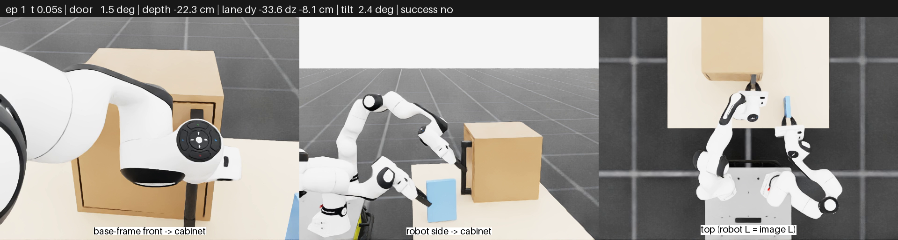
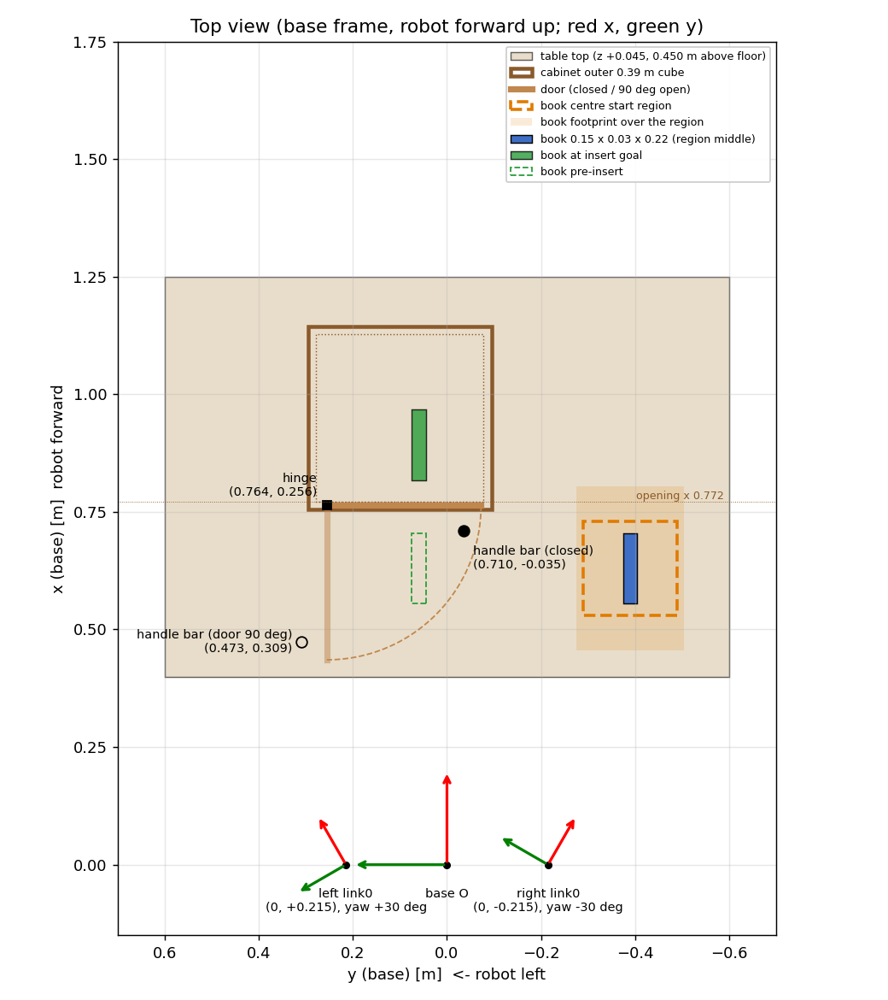
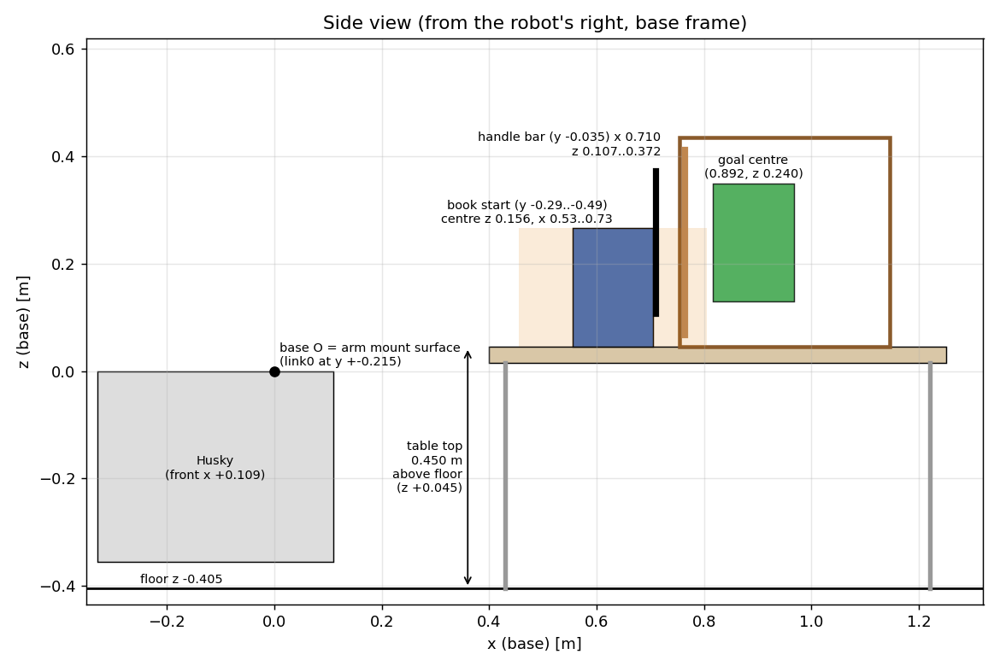

> 학습 환경: `dual_fr3_lab`의 `Isaac-Cabinet-BookInsert-DualFR3-UMI-*` (설정 `tasks/manager_based/cabinet_book_insert/cabinet_book_insert_env_cfg.py`, 수납장 모델 `assets/cabinet_book/cabinet_book_insert.xml`). 값은 sim을 리셋한 상태에서 직접 읽었다(2026-11-06, 시작 행 60). 노드 사용법은 [../fr3_husky_nn_policy/CABINET_BOOK_INSERT_DEPLOYMENT.md](../fr3_husky_nn_policy/CABINET_BOOK_INSERT_DEPLOYMENT.md).

# 캐비닛 책 넣기 실로봇 배치 기준 (2026-11-06)

왼손은 수납장 손잡이를, 오른손은 책을 잡은 상태에서 시작한다. 왼손으로 문을 90° 열고 오른손으로 책을 수납장 안에 넣는다.
이 문서는 정책이 학습한 책상, 수납장, 책 위치를 실물에서 재현하기 위한 좌표 기준이다. v2 정책(open-door 2499, closed-door 7498)과 v3(Slow) 모두 같은 배치다.



## 좌표계

- 원점 O는 로봇 root frame `base`다. 팔 장착 상판 윗면, 두 팔 장착점(link0 원점)을 이은 선의 중점이다.
- 축: x 로봇 정면, y 로봇 왼쪽, z 위.
- 정책 관측(책 위치, 목표)과 노드의 `base` frame이 이 frame이다.
- **link0** (sim에서 확인: link1 yaw − joint1 = link0 yaw):

  | | 위치 (base) | yaw |
  |---|---|---|
  | left link0 | (0, +0.215, 0) | +30° (x축이 앞-왼쪽) |
  | right link0 | (0, −0.215, 0) | −30° (x축이 앞-오른쪽) |

- link0 기준 좌표 = Rz(−yaw) · (p_base − link0 위치). z는 base와 같다(link0 원점이 장착면 위).
- 실물 URDF(`fr3_husky_description`, `mobile:=true`)의 base → link0도 같다([box 배치 문서](dual_fr3_box_real_setup.md) "실물 URDF와 대조").

### 바닥 높이 주의

- sim은 장착면이 바닥 위 **0.405 m**다. 그래서 책상 윗면이 바닥 위 **0.450 m**다.
- URDF 바퀴 collision 기준이면 바닥이 −0.392라, 같은 책상 윗면이 바닥 위 0.437 m가 된다.
- **정책에 중요한 것은 바닥이 아니라 장착면(base) 기준 높이다.** 책상 윗면은 팔 장착면보다 **4.5 cm 위**(z +0.045)에 있어야 한다. 실물은 장착면에서 직접 재서 맞춘다.

## 그림

| 위 (+x 위쪽, 로봇 왼쪽 = 화면 왼쪽) | 옆 (로봇 오른쪽에서 +y 방향으로) |
|---|---|
|  |  |

- 화살표: x 빨강, y 초록. base O는 0.2 m, link0은 0.12 m다.
- 갈색 굵은 선: 수납장 바깥, 점선: 안쪽(입구 x 0.772). 문은 닫힘(진한 선)과 90° 열림(연한 선)을 그렸고, 점선 호는 문 끝이 지나가는 길이다.
- 주황 점선: 책 **중심** 시작 범위. 연한 주황: 그 범위에서 책 밑면이 차지할 수 있는 영역. 파랑: 범위 한가운데 책. 초록: 넣은 목표(실선), 넣기 직전(점선).
- 옆 그림의 책과 손잡이는 y가 다르다(책 y −0.29 ~ −0.49, 손잡이 y −0.035).

## 배치 값

### 책상

| 항목 | 값 |
|---|---|
| 윗면 높이 | base z **+0.045** (sim 바닥 위 0.450 m) |
| 윗면 범위 (sim) | x 0.40 ~ 1.25, y −0.60 ~ +0.60 (0.85 × 1.20 m), 두께 3 cm |
| 윗면 중심 pose | base (0.825, 0, 0.045), yaw 0 |

- 책상 크기 자체는 정책에 들어가지 않는다. 수납장과 책 시작 범위(밑면 x 0.455 ~ 0.805, y −0.505 ~ −0.275)를 받치고, 윗면이 같은 높이면 된다.
- 앞 모서리는 x 0.455보다 앞(로봇 쪽)이어야 책이 책상 위에 선다. sim은 0.40이다.

### 수납장

| 항목 | 값 |
|---|---|
| 바깥 크기 | 0.39 × 0.39 × 0.39 m (벽 17 mm, 안쪽 0.356 m) |
| pose (밑면 중심) | base (0.950, 0.100, 0.045), yaw 180° (문이 로봇을 봄) |
| 앞면 (문 바깥면) | x 0.755, y −0.095 ~ +0.295, z 0.045 ~ 0.435 |
| 입구 (안쪽 앞) | x 0.772 |
| 문 | 0.345 × 0.345 × 0.017 m, 경첩은 로봇 왼쪽 |
| 경첩 축 (수직) | base (0.7635, 0.2555), z 0.045 ~ 0.435 |
| 문 열림 | 손잡이를 로봇 쪽으로 당기며 왼쪽으로 돈다. 0 → 90° (sim 한계 120°) |
| 손잡이 | 수직 원통 막대 Ø30 mm, 길이 265 mm. 막대 축이 문 바깥면에서 45 mm 앞, 문 중심에서 오른쪽(문 끝 쪽)으로 135 mm |
| 손잡이 막대 축 (닫힘) | base (0.710, −0.035), z 0.1075 ~ 0.3725 (가운데 0.240) |
| 손잡이 막대 축 (90° 열림) | base (0.473, 0.309, 0.240) |
| 문 동역학 (sim) | 경첩 감쇠 0.5 ~ 3.0 N·m·s/rad (DR), 스프링 0.2 N·m/rad |

- 실물 수납장 치수가 다르면 다음 순서로 맞춘다: **경첩 축 위치**, **손잡이 막대 위치**(닫힘), 입구 x와 책 레인(y 0.06, z 0.24) 순이다. 정책은 손잡이를 따라 문을 열고, 책을 레인에 넣는다.

### 책

| 항목 | 값 |
|---|---|
| 크기 | x 0.15 (넣는 방향) × y 0.03 (잡는 두께) × z 0.22 (높이) m |
| 무게 (sim DR) | 0.2 ~ 0.5 kg |
| 시작 자세 | 책상 위에 세움, 면이 base 축과 평행 (base yaw 0 = left link0 기준 −30°, right link0 기준 +30°) |
| 중심 시작 범위 | x **0.53 ~ 0.73**, y **−0.49 ~ −0.29**, z 0.156 (밑면이 책상 위 1 mm) |
| 시작 행 | 11 × 11 = 121개, 2 cm 간격. 행마다 시작 관절값이 NPZ에 들어 있다 |
| 밑면이 차지할 수 있는 영역 | x 0.455 ~ 0.805, y −0.505 ~ −0.275 |
| 넣기 직전 (중심) | base (0.630, 0.060, 0.240) |
| 목표 (중심) | base (0.892, 0.060, 0.240) = 입구에서 12 cm 안, 수납장 중심 y보다 4 cm 오른쪽 |
| 성공 | 중심이 입구에서 9 cm 이상 안, y·z 오차 3 cm 미만, 기울기 10° 미만 (v3는 14 cm 이하, 문 85° 이상 추가) |

### 파지 (UMI TCP = link7 + 0.2844 m)

- 왼손: 손잡이 막대를 손가락 사이에 둔다. 접근 방향이 수평에서 45° 아래로 기울어 있고, 손끝이 막대 축을 2 cm 지난다. 손목은 flip False다(학습 때 특이 자세를 피한 방향).
  - 닫힘 상태 왼손 TCP: base (0.724, −0.035, 0.226). FK 노드 `left_tcp_closed_position_base`의 sim 값이다.
- 오른손: 책의 뒷면(−x, 로봇 쪽)에서 두께 방향(y)으로 잡는다. 접근이 45° 아래로 기울어 있고, 손끝이 뒷면에서 2 cm 안이다. 손목은 flip True다.

## 주요 점의 좌표 (base / left link0 / right link0)

단위 m. 뒤의 각도는 yaw다(그 frame 기준).

| 점 | base | left link0 | right link0 |
|---|---|---|---|
| 바닥 (base 원점 바로 아래, sim) | +0.000, +0.000, −0.405 | −0.107, −0.186, −0.405 | −0.107, +0.186, −0.405 |
| 책상 윗면 중심 | +0.825, +0.000, +0.045 / +0° | +0.607, −0.599, +0.045 / −30° | +0.607, +0.599, +0.045 / +30° |
| 책상 앞-왼쪽 모서리 (sim) | +0.400, +0.600, +0.045 | +0.539, +0.133, +0.045 | −0.061, +0.906, +0.045 |
| 책상 앞-오른쪽 모서리 (sim) | +0.400, −0.600, +0.045 | −0.061, −0.906, +0.045 | +0.539, −0.133, +0.045 |
| 수납장 밑면 중심 | +0.950, +0.100, +0.045 / +180° | +0.765, −0.575, +0.045 / +150° | +0.665, +0.748, +0.045 / −150° |
| 수납장 앞면 아래 왼쪽 모서리 (경첩 쪽) | +0.755, +0.295, +0.045 | +0.694, −0.308, +0.045 | +0.399, +0.819, +0.045 |
| 수납장 앞면 아래 오른쪽 모서리 (손잡이 쪽) | +0.755, −0.095, +0.045 | +0.499, −0.646, +0.045 | +0.594, +0.481, +0.045 |
| 경첩 축 (가운데 높이) | +0.763, +0.256, +0.240 | +0.681, −0.347, +0.240 | +0.426, +0.789, +0.240 |
| 손잡이 막대 축 가운데 (닫힘) | +0.710, −0.035, +0.240 | +0.490, −0.572, +0.240 | +0.525, +0.511, +0.240 |
| 손잡이 막대 축 가운데 (90° 열림) | +0.473, +0.309, +0.240 | +0.457, −0.155, +0.240 | +0.148, +0.690, +0.240 |
| 왼손 TCP (닫힘) | +0.724, −0.035, +0.226 | +0.502, −0.579, +0.226 | +0.537, +0.518, +0.226 |
| 책 중심 시작, 범위 한가운데 (행 60) | +0.630, −0.390, +0.156 / +0° | +0.243, −0.839, +0.156 / −30° | +0.633, +0.163, +0.156 / +30° |
| 책 중심 시작, x 최소 · y 최대 | +0.530, −0.290, +0.156 | +0.206, −0.702, +0.156 | +0.496, +0.200, +0.156 |
| 책 중심 시작, x 최소 · y 최소 | +0.530, −0.490, +0.156 | +0.106, −0.876, +0.156 | +0.596, +0.027, +0.156 |
| 책 중심 시작, x 최대 · y 최대 | +0.730, −0.290, +0.156 | +0.380, −0.802, +0.156 | +0.670, +0.300, +0.156 |
| 책 중심 시작, x 최대 · y 최소 | +0.730, −0.490, +0.156 | +0.280, −0.976, +0.156 | +0.770, +0.127, +0.156 |
| 책 중심 넣기 직전 | +0.630, +0.060, +0.240 / +0° | +0.468, −0.449, +0.240 / −30° | +0.408, +0.553, +0.240 / +30° |
| 책 중심 목표 | +0.892, +0.060, +0.240 / +0° | +0.695, −0.580, +0.240 / −30° | +0.635, +0.684, +0.240 / +30° |

## 실물에 맞추는 순서 (제안)

로봇을 측정 도구로 쓰면 줄자보다 정확하다. 시작 행의 관절값으로 팔을 보내면, 손가락이 sim의 손잡이와 책 위치에 온다.

1. 책상 윗면을 장착면 기준 +0.045 m로 맞춘다.
2. 노드에 NPZ를 올리면 시작 행이 들어 있다. 쓸 행을 고른다(가운데는 행 60, 책 중심 (0.63, −0.39)).
   - `start_policy`가 거부하면, 가장 가까운 행으로 가는 `move_to_joint` 명령을 로그에 출력한다.
   - 행 60:
     ```bash
     ros2 run fr3_husky_task_manager move_to_joint \
       --left-target-positions -0.2898 0.4389 -0.6271 -1.8862 1.4038 2.7138 -0.6641 \
       --right-target-positions -1.4168 1.1355 1.3881 -2.4121 -2.0347 2.6719 1.6555
     ```
   - 왼팔 시작 관절값은 121개 행이 모두 같다(문 닫힘). open-door 정책은 왼팔이 문 90° 자세에서 시작한다(NPZ 행에 반영됨).
   - MoveIt은 수납장과 책을 모른다. 팔을 보낼 때는 수납장과 책을 치워 둔다.
3. 왼손 그리퍼를 연 채로 수납장을 놓는다. 손잡이 막대가 손가락 사이, 손끝이 막대를 약 2 cm 지나게 맞춘 뒤 잡는다.
   - 이때 문이 닫혀 있어야 하고, 수납장 앞면이 base y축과 평행해야 한다(yaw 180°).
4. 책을 오른손 손가락 사이에 세워 놓고 잡는다. 책 밑면이 책상에 닿고, 면이 base 축과 평행해야 한다.
5. FK 노드 보정: `hinge_position_base`는 경첩 축 (0.7635, 0.2555, 0.24), `left_tcp_closed_position_base`는 3번에서 잡은 상태의 `/cabinet_book_insert/left_tcp_pose`다(sim 값 (0.724, −0.035, 0.226)).
   - 문을 조금 열어 `/cabinet_book_insert/door_angle`이 커지는지 본다.
6. shadow mode로 `start_policy` → trace의 관측(책 위치, 문 각도)이 sim 시작값과 맞는지 확인한 뒤 command mode로 간다.

## 남은 차이 (확인 필요)

- 실물 수납장은 `fr3_husky_description`에 모델이 없다. sim 수납장은 codex MJCF를 고친 것이다(손잡이를 문 앞면으로 옮김). 실물 치수가 다르면 위 순서대로 경첩과 손잡이 위치를 우선 맞춘다.
- sim은 두 손이 손잡이와 책에 **고정 관절로 붙어 있다**. 실물 그리퍼는 미끄러질 수 있다. v2 정책은 sim에서 손잡이에 중앙 56 N(최대 448 N)을 썼다. 실물 UMI 파지가 이를 버티지 못할 수 있다(v3는 30 N 초과에 강한 페널티).
- 책 위치 관측은 오른손 FK + 파지 변환이다(카메라 없음). 책이 손 안에서 돌면 관측이 틀린다.
