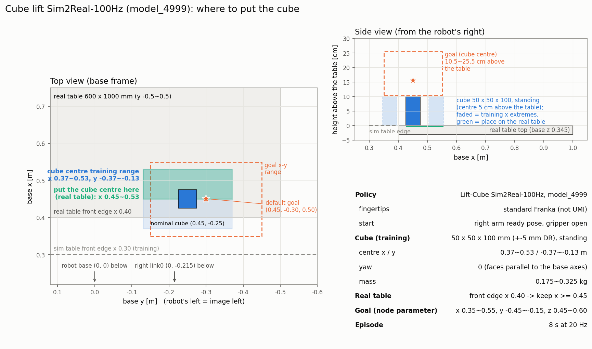

# dual FR3 큐브 들기 (Isaac Lab 3.0 Sim2Real-100Hz) 실로봇 실험 순서 (2026-11-07)

목적: 3.0.0 큐브 들기 정책을 실로봇에 올려 **Franka 그리퍼 지연**을 잰다. 잰 값은 이후 큐브 pick-and-place 학습(`Isaac-PickPlace-Cube-DualFR3-UMI-v0`)에 넣는다.



그림 다시 그리기 (dual_fr3_lab): `python scripts/tools/draw_liftcube_layout.py --out ~/etri_ws/src/fr3_husky_etri/docs/figures/liftcube_sim2real_layout.png`

## 정책

| | |
|---|---|
| 모델 | `fr3_husky_nn_policy/models/dual_fr3_lift_sim2real100hz_model4999.npz` (설명 `..._model4999.yaml`) |
| 학습 | `Isaac-Lift-Cube-DualFR3-Sim2Real-100Hz-v0`, `logs/rsl_rl/dual_fr3_lift_sim2real_100hz/2026-10-22_18-14-56/model_4999.pt` |
| export | `python -m fr3_husky_nn_policy.export_ppo_actor <ckpt> models/dual_fr3_lift_sim2real100hz_model4999.npz --output-activation tanh` (torch tanh(mean)과 최대 차 2.6e-6) |
| 관측 36 | 오른팔 q − ready 9(관절 7 + 손가락 2), qdot 9, 큐브 중심 3, 목표 3, 목표 quat [0,0,0,1], 이전 행동 8 |
| 행동 8 | 팔: q_target = q + clip(0.1·a, ±0.1 rad), 20 Hz, Isaac PD. 그리퍼: a[7] < 0이면 닫기 |
| 노드 | `ppo_liftcube_sim2real_policy_node` (launch `dual_fr3_lift_sim2real_policy.launch.py`, config `dual_fr3_lift_sim2real100hz.yaml`) |

### 예전 v3 노드(`ppo_liftcube_policy_node`)와 다른 점

- 제어기의 Isaac PD 경로(`isaac_relative_control`)는 `robot_name: dual`만 받고, dual은 그리퍼를 다루지 않는다. 그래서:
  - 팔: dual goal로 14개 목표를 보낸다. **왼팔은 시작할 때 각도에 고정**, 오른팔만 정책이 움직인다.
  - 그리퍼: 노드가 franka action `/right_franka_gripper/grasp`(width 0, speed 0.1 m/s, force 30 N, epsilon 0.08)와 `/right_franka_gripper/move`(width 0.08, speed 0.1 m/s)를 직접 보낸다. 제어기의 GripperGrasp/GripperOpen과 같은 값이다. 열고 닫는 명령이 바뀔 때만 보낸다(히스테리시스 0.1).
- 보낸 시각, accepted, result를 모두 로그에 남긴다(아래 "로그").
- 비전 끊김 처리는 없다. 큐브 pose가 0.2 s 넘게 안 오면 세션을 멈춘다(`object_pose_timeout_s`).
- 목표 주는 방식은 box lift와 같다: `goal_xy_reference` + `goal_xy_offset_m`, 높이 `goal_z_m` (아래 "목표 주기", 2026-11-07).
- 세션이 끝나면 최종 큐브 위치와 목표의 차이를 `experi_result/<log_task_name>/results.csv`에 한 줄 남긴다 (아래 "로그").
- 관절 상태는 box·캐비닛 노드와 같다. 팔은 `/dual_fr3/joint_states`(ros2_control, 1 kHz)에서 받는다.
  - `/joint_states`는 joint_state_publisher가 팔과 그리퍼를 합쳐 30 Hz로만 내므로 쓰지 않는다.
  - 손가락은 `/right_franka_gripper/joint_states`에서 받는다.

## 관측과 실로봇 출처

관측 36개는 모두 실로봇에서 얻는다. 그리퍼와 큐브 위치는 sim과 실물의 값이 다르다.

| 번호 | 관측 | sim (학습) | 실로봇 출처 |
|---|---|---|---|
| 0~6 | 오른팔 관절 q − ready 자세 | 잡음 0.005 rad | `/dual_fr3/joint_states` (FR3 엔코더) |
| 7~8 | 손가락 q − 0.04 | 잡음 0.005 | `/right_franka_gripper/joint_states` (폭/2) |
| 9~15 | 오른팔 관절 속도 | 잡음 0.05 rad/s | `/dual_fr3/joint_states` velocity |
| 16~17 | 손가락 속도 | 잡음 0.05 | 그리퍼 폭을 노드가 미분. franka_gripper는 측정 속도를 내지 않는 것으로 판단(실물 미확인) |
| 18~20 | 큐브 중심 위치 (base) | 실제 위치 + 잡음 1 cm, 지연·끊김 없음 | 비전 `/cube_tf` (`object_pose_topic`, TF로 base 변환, + `object_position_offset_m`) |
| 21~23 | 목표 위치 | 무작위 명령 (x 0.35~0.55, y −0.45~−0.15, z 0.45~0.60, 큐브와 무관) | `goal_xy_reference` + `goal_xy_offset_m`, `goal_z_m` (아래 "목표 주기") |
| 24~27 | 목표 quat | [0, 0, 0, 1] 고정 | 상수 |
| 28~35 | 이전 행동 8 | | 노드가 기억 |

### sim과 달라지는 곳

| | sim | 실물 |
|---|---|---|
| 그리퍼 (관측 7~8, 16~17) | implicit PD(stiffness 2e3)라 약 0.1 s에 닫힘. 명령 지연 없음 | action goal → libfranka. 0.1 m/s로 움직임(손가락 하나 0.05 m/s). 8 cm → 5 cm 큐브까지 0.3 s 이상에 명령 지연이 더해짐 |
| 큐브 위치 (관측 18~20) | 실제 위치 + 잡음 1 cm, 매 step 새 값 | ArUco 처리 지연이 있음. 쥐면 손이 마커를 가릴 수 있음 |
| 큐브 방향 | 관측 안 함, yaw 0만 학습 | 정책이 yaw를 못 보므로 큐브를 base 축에 나란히 놓아야 함 |
| 큐브 질량 | 0.175~0.325 kg | 90 g |
| 힘·접촉 | 관측 안 함 | 잡았는지는 손가락 폭으로만 앎 |

## 이번 실험에서 볼 것 (pick-and-place에 넣을 값)

이 실험의 목적은 아래 값을 재서 pick-and-place 학습(`Isaac-PickPlace-Cube-DualFR3-UMI-v0`)의 그리퍼 모델, 비전 지연과 끊김에 넣는 것이다.

| 볼 것 | 어디서 | 쓰임 |
|---|---|---|
| 그리퍼 명령 지연: send → accepted → 손가락이 움직이기 시작 → result | `liftcube_log_summary`의 gripper 표 (`gripper_events.csv`, `trace.csv`의 `finger_width_m`) | sim 그리퍼에 명령 지연과 닫힘 속도를 넣음 |
| 닫힘 속도: 폭이 줄어드는 기울기, 큐브를 쥔 뒤 폭 | `trace.csv`의 `finger_width_m`, `obs_16`·`obs_17` | sim 손가락 속도 제한(현재 거의 즉시) |
| 닫기 명령에서 큐브가 들리기까지 걸린 시간 | 요약의 `lift start` 줄 | 정책이 손가락이 다 닫히기 전에 드는지 확인. 그렇다면 sim 그리퍼를 늦춰야 함 |
| 열기 명령 지연 (정책이 열 때만) | gripper 표의 `open` 줄 | 놓기(place) 단계 지연 |
| 큐브 pose 지연 | 요약의 `cube age` (`object_stamp_age_ms`는 카메라 stamp부터, `object_pose_age_ms`는 노드가 받은 뒤부터) | 비전 지연 DR 범위 (box 값과 비교) |
| 큐브 pose 끊김 | 쥔 뒤 `cube pose is stale` 종료 여부, `object_pose_age_ms` 최댓값 | 끊김 확률과 길이, 노드의 "마지막 값 유지"가 필요한지 |
| 정지한 큐브의 위치 흔들림 | 요약의 `cube noise` 줄 (처음 1 s, 손이 닿기 전) | 관측 잡음(현재 1 cm)이 맞는지 |
| 손가락 속도 관측이 실제로 나오는지 | `obs_16`, `obs_17`이 닫는 동안 0이 아닌지 | 미분이 제대로 되는지 |
| tick 주기, 관절 상태 나이, 제어기 추종 오차 | 요약의 `tick`, `joint err` | 20 Hz 정책 루프가 학습과 같은지 |

- shadow 실행(4번)에서는 그리퍼 명령을 보내지 않는다. 그리퍼 지연을 빼고 큐브 pose 지연과 흔들림만 본다.
- 그리퍼 지연만 따로 보려면 정책 없이 `ros2 action send_goal /right_franka_gripper/grasp ...`를 보내고 `ros2 topic echo /right_franka_gripper/joint_states`로 폭을 볼 수도 있다.
  - 이때는 정책 노드 로그가 남지 않으니, 시간은 `ros2 bag record /right_franka_gripper/joint_states`로 남긴다.

## 측정 결과 (2026-11-07 ~ 11-08, 실로봇)

출처:
- **그리퍼 전용 측정 (2026-11-08, 오른손, 팔 정지)**: `data/gripper_latency/20261108_010355_KST`(speed 0.1, grasp/open 10회), `20261108_010600_KST`(speed 0.05, grasp·Move 닫기·open 10회), `20261108_011045_KST`(speed 0.1, grasp·Move 닫기·open 10회 + 이미 열린 상태의 Move 11회). 아래 "그리퍼 지연 측정 스크립트"로 쟀다.
- 큐브 리프트 command 세션 4개: `data/dual_fr3_liftcube_sim2real100hz/20261107_21*~22*_KST/` (`trace.csv`, `gripper_events.csv`)
- launch 로그: `~/.ros/log/2026-11-07-*`, `2026-11-08-*`의 `launch.log` (franka_gripper `Received ... request` → `... succeeded`, 224건)

### 그리퍼 (오른손, 빈 손가락, 2026-11-08 전용 측정)

| 명령 | speed | n | onset (명령 → 움직임 시작, 추정) | 90 % 도달 | 실제 속도 (폭 합) | result |
|---|---|---|---|---|---|---|
| grasp 75 → 0 mm | 0.10 | 20 | **0.65 s** (0.49~0.84) | 1.41~1.50 s | 0.100~0.108 m/s | 1.79~1.83 s |
| grasp | 0.05 | 10 | **0.67 s** (0.56~0.75) | 2.11 s | 0.050 m/s | 2.48 s |
| Move 닫기 75 → 10 mm | 0.10 | 10 | 0.67 s (0.47~0.89) | 1.40 s | 0.099 m/s | 1.74 s |
| Move 닫기 | 0.05 | 10 | 0.64 s (0.50~0.92) | 1.98 s | 0.049 m/s | 2.24 s |
| open (Move) 0 → 75 mm | 0.10 | 30 | **0.68~0.73 s** (0.51~1.38) | 1.45~1.49 s | 0.088~0.100 m/s | 1.77~1.80 s |
| open | 0.05 | 20 | 0.58 s (0.44~0.79) | 2.04 s | 0.049 m/s | 2.30 s |
| Move, 이미 열림 (안 움직임) | 0.10 | 12 | — | — | — | **0.75 s** (0.65~0.98) |

- **명령 → 손가락이 움직이기 시작까지 약 0.65 s**(0.45~0.9 s)다. grasp·Move, 닫기·열기, 속도 0.05·0.1 모두 같다. 손가락이 움직이지 않는 Move도 result까지 0.75 s 걸리니, 명령 처리 자체가 0.6~0.7 s다.
- 움직이기 시작하면 **명령한 속도 그대로** 간다(0.05 → 0.049~0.050, 0.1 → 0.088~0.108 m/s, 두 손가락 폭 합). 끝에서 감속·확인에 약 0.3~0.4 s(90 % → result).
- **손가락 폭 관측이 약 0.27 s마다 바뀐다**(p95 0.38 s). `/right_franka_gripper/joint_states`는 10.4 Hz지만 같은 값이 2~3번 반복된다(franka_gripper가 그리퍼 상태를 약 3.7 Hz로 읽는다). 정책의 손가락 관측(obs 7~8, 16~17)은 실물에서 최대 약 0.3 s 늦고 계단 모양이다.
- onset은 폭이 처음 바뀐 샘플(motion, 상한)에서 측정 속도로 거슬러 올라간 값이다. 폭 관측 간격 때문에 개별 값은 ±0.15 s 정도 흔들린다.
- accept(명령 → goal accepted)는 중앙 10~70 ms(최대 0.19 s). 왼손은 재지 않았다(같은 Franka Hand, 같은 노드).
- 11-07 큐브 리프트 trace 1건에서 0.6 s / 0.08 m/s로 봤던 값은, 같은 0.27 s 관측 간격 때문에 속도를 작게 잰 것이었다. 위 표가 맞다.
- launch 로그: 손으로 보낸 grasp 오른손 72건 중앙 1.79 s, 왼손 58건 2.28 s, homing 7.3~7.8 s.

### 비전 (큐브 pose, `/cube_tf`, 11-07 큐브 리프트 세션)

| 항목 | 값 |
|---|---|
| 노드 도착 기준 나이 (`object_pose_age_ms`) | 평균 12~23 ms, 최대 33 ms |
| 카메라 stamp 기준 나이 (`object_stamp_age_ms`) | 평균 22~32 ms, 최대 43 ms |
| 정지한 큐브 위치 흔들림 (std, 처음 1 s) | x 1.8~4.2, y 0.4~2.2, z 0.3~2.0 mm (sim 잡음 10 mm) |

### sim에 넣을 값

| 항목 | 제안 | sim 지금 |
|---|---|---|
| 그리퍼 명령 지연 (닫기·열기 같음) | **0.45~0.9 s** 균일 (중앙 0.65 s, policy step 50 ms로 9~18 step) | 0 |
| 손가락 속도 | 명령 속도 (0.1 m/s면 두 손가락 합 0.09~0.11 m/s, 한 손가락 0.05) | implicit PD, 약 0.1 s에 닫힘 |
| 끝 확인 시간 | 0.3~0.4 s (다음 명령을 받기 전까지) | 0 |
| 손가락 관측 | 0.25~0.38 s마다 갱신(sample-and-hold) | 매 step |
| 큐브 pose 지연 | 20~50 ms (0~1 step) | 0 |
| 큐브 pose 잡음 | 2~5 mm | 10 mm |

- 명령 처리 중에는 다음 명령이 늦게 반영된다(11-07 세션 `220138`: grasp가 끝나기 전에 보낸 open의 result가 늦었다). sim에서도 한 명령이 끝날 때까지 다음 명령을 대기시키는 것이 실물에 가깝다.

### 그리퍼 지연 측정 스크립트 (`gripper_latency_probe`, 2026-11-08)

팔은 움직이지 않는다. 그리퍼에 open(Move) → grasp → open을 반복해 보내고 그리퍼 joint_states를 전부 기록한 뒤 명령마다 계산한다.

| 값 | 뜻 |
|---|---|
| accept | 명령 → goal accepted |
| onset | 명령 → 움직임 시작 추정 (motion 샘플에서 측정 속도로 거슬러 올라감, **sim에 넣을 명령 지연**) |
| motion | 명령 → 손가락 폭이 1 mm 넘게 바뀐 첫 샘플 (상한) |
| 90% | 명령 → 이동 거리 90 % 도달 |
| speed | 이동 10~90 % 구간에서 폭 값이 바뀐 샘플들의 직선 기울기 (두 손가락 합, m/s) |
| result | 명령 → action result |
| settle | 손가락이 멈춘 뒤 → result (서버가 기다리는 시간) |

준비: 로봇 launch가 `load_gripper:=true`로 떠 있으면 된다(큐브 lift launch 등, 정책은 시작하지 않는다). 손가락 사이를 비운다.

```bash
cd ~/jw_ws/src/fr3_husky && source ~/jw_ws/install/setup.bash
# 기본: 오른손, speed 0.1 m/s (큐브 lift 노드와 같음), 10회
ros2 run fr3_husky_nn_policy gripper_latency_probe --side right --cycles 10 --speeds 0.1
# 속도별 + Move로 닫기(grasp와 비교) + 이미 열린 상태의 Move(명령 고정 지연)
ros2 run fr3_husky_nn_policy gripper_latency_probe --side right --cycles 10 --speeds 0.05 0.1 --move-close --idle-open
# 물체를 쥘 때: 큐브(50 mm)를 손가락 사이에 들고 실행
ros2 run fr3_husky_nn_policy gripper_latency_probe --side right --cycles 5 --speeds 0.1
# 다시 분석만
ros2 run fr3_husky_nn_policy gripper_latency_probe --analyze data/gripper_latency/<시각>
```

- 결과: `data/gripper_latency/<시각>/`. `widths.csv`(모든 그리퍼 joint state), `events.csv`(명령마다 보낸·accepted·result 시각), `summary.csv`(명령마다 지표), `summary.json`(명령·속도별 median/min/max/std, joint state 주기).
- 터미널에 명령·속도별 median [min-max] 표가 나온다. 실물은 폭 값이 약 0.27 s마다만 바뀌어서, 같은 값이 반복되는 샘플은 빼고 바뀐 샘플만으로 속도와 onset을 계산한다. 맨 위 줄에 joint state 주기와 폭 갱신 간격을 출력한다.
- 시작 전에 "Fingers clear?"를 묻는다(`--yes`로 건너뜀). Ctrl+C로 멈추면 그때까지 기록한 것을 분석한다.
- 가짜 그리퍼(명령 지연 grasp 0.5 s / Move 0.2 s, 0.08 m/s, 15 Hz)로 확인: motion grasp 0.55~0.58 s, Move 0.23~0.28 s, speed 0.049/0.079 m/s(명령 0.05/0.1)로 나왔다.

## 준비

1. **손끝을 기본 Franka 팁으로 바꾼다.** 이 정책은 기본 팁(TCP가 link7에서 0.2104 m)으로 학습했다. UMI 팁은 7.4 cm 더 길다.
2. 큐브: 50 × 50 × 100 mm, 세워서 놓는다.
3. 비전 노드가 `geometry_msgs/PoseStamped`로 **큐브 중심**을 낸다(예: `/cube_tf`). 책상 위에 선 큐브라면 base z가 약 0.395다.
   - `frame_id`는 `base`가 아니어도 된다. TF로 `base`까지 이어지면 노드가 바꾼다(box lift `/box_tf`와 같다).
   - 정책은 **위치 3개만** 본다. 회전은 로그(`object_quat_raw_*`, 결과 tilt)에만 쓴다.
   - 마커 윗면 pose를 그대로 내면 z가 약 0.445가 되어 시작 검사에서 걸린다. 비전 z가 일정하게 높으면 `object_position_offset_m:="[0.0, 0.0, -0.05]"`처럼 정책 입력에서만 뺀다.

## 큐브 놓는 곳

| | 값 (base frame) |
|---|---|
| 큐브 중심 x | **0.45 ~ 0.53** (학습 0.37 ~ 0.53. 실제 책상 앞 모서리가 x 0.40이라 앞쪽은 못 씀) |
| 큐브 중심 y | −0.37 ~ −0.13 (가운데 −0.25) |
| yaw | **0**: 큐브 면을 base 축에 나란히. 학습에 yaw 무작위화가 없었다 |
| 추천 첫 위치 | (0.48, −0.25) |
| 목표 (기본) | `range_center` (0.45, −0.30) + offset (0, 0), z 0.50 = 책상 위 15.5 cm. 범위 x 0.35~0.55, y −0.45~−0.15, z 0.45~0.60 |

노드 시작 검사 범위는 x 0.36~0.54, y −0.38~−0.12, z 0.365~0.425다(학습 범위 ±1 cm).

## 목표 주기 (box lift와 같은 방식)

목표 = 기준점 x/y + `goal_xy_offset_m`, z = `goal_z_m` (base frame 절대값). `start_policy` 때 고정된다.

| `goal_xy_reference` | 기준점 | offset 허용 범위 |
|---|---|---|
| `range_center` (기본) | 학습 목표 범위 중앙 (0.45, −0.30). 큐브 위치와 무관한 고정점 | x −0.10~+0.10, y −0.15~+0.15 |
| `cube_start` | `start_policy` 때 큐브 x/y | 큐브 위치 + offset이 x 0.35~0.55, y −0.45~−0.15 안 |

- 학습은 목표를 위 범위 안에서 큐브와 상관없이 고르게 뽑았다. 그래서 기본값을 `range_center`로 했다.
- `goal_z_m` 허용 범위는 0.45~0.60 (책상 위 10.5~25.5 cm)이다.
- 목표 회전은 [0,0,0,1]로 고정이고 학습하지 않았다.
- launch 인자(`goal_z_m:=0.55 goal_xy_offset_m:="[0.05, 0.0]" goal_xy_reference:=range_center`)로 주거나, 노드가 떠 있을 때 IDLE에서 바꾼다:

```bash
ros2 param set /ppo_liftcube_sim2real_policy_node goal_z_m 0.55
ros2 param set /ppo_liftcube_sim2real_policy_node goal_xy_offset_m "[0.05, -0.05]"
ros2 param set /ppo_liftcube_sim2real_policy_node goal_xy_reference cube_start
```

- 범위를 벗어나면 `Setting parameter failed: ...`로 거부한다. `cube_start`는 큐브를 놓은 뒤 `start_policy`에서 검사한다.
- RViz (`fr3.rviz`):

| 표시 | 토픽 | 색 |
|---|---|---|
| Cube-lift goal | `~/goal_marker` | 초록(IDLE 미리보기, 범위 밖이면 빨강). start 뒤에는 고정된 목표 |
| Cube-lift policy cube | `~/cube_marker` | 주황. 정책이 보는 큐브(offset 적용) |
| Cube-lift trained ranges | `~/range_markers` | 파랑: 큐브 시작 x/y 범위(책상 위), 초록 선: 목표 범위 상자 |

## 1. 터미널 1: 제어기 + 정책 노드 (shadow)

```bash
cd ~/jw_ws && source install/setup.bash
ros2 launch fr3_husky_nn_policy dual_fr3_lift_sim2real_policy.launch.py shadow_mode:=true launch_move_group:=true \
  object_pose_topic:=/cube_tf goal_xy_reference:=range_center goal_z_m:=0.50 goal_xy_offset_m:="[0.0, 0.0]"
```

- 기본값은 `load_gripper:=true`(그리퍼 action server 필요), `with_realsense:=false`다.
- 목표는 위 "목표 주기"대로 바꾼다(다음 start부터 적용).
- 로그 확인: `Loaded ...dual_fr3_lift_sim2real100hz_model4999.npz (36->8 tanh ...), mode=SHADOW`.

## 2. 터미널 2: 비전

비전 노드(`/cube_tf`)를 띄운다. 다음 명령으로 확인한다.

```bash
ros2 topic hz /cube_tf
ros2 topic echo /cube_tf --once
```

RViz의 주황 큐브(Cube-lift policy cube)가 실제 큐브와 겹치고, base z가 0.395 근처면 된다.

## 3. 터미널 3: ready 자세, 그리퍼 열기

```bash
ros2 run fr3_husky_task_manager move_to_joint        # 기본값이 학습 ready 자세 (오른팔 0.5236 -0.7854 0 -2.3562 0 1.5708 0.7854)
ros2 action send_goal /right_franka_gripper/move franka_msgs/action/Move "{width: 0.08, speed: 0.1}"
```

큐브를 위 표의 위치에 놓는다.

## 4. shadow로 한 번 확인

```bash
ros2 service call /ppo_liftcube_sim2real_policy_node/start_policy std_srvs/srv/Trigger {}
```

- 명령은 보내지 않고, 8 s 동안 추론과 로그만 남긴다.
- 그리퍼는 `would_send` 이벤트로만 남는다.
- 끝나면 `ros2 run fr3_husky_nn_policy liftcube_log_summary`로 큐브 위치, tick, 지연을 본다.

시작이 거부되면 메시지대로 고친다.

| 메시지 | 고칠 것 |
|---|---|
| `cube ... outside the training start region` | 큐브 위치. z가 0.44 근처면 ArUco가 큐브 중심이 아닌 마커 pose를 내는 것 |
| `right arm is not at the training ready pose` | `move_to_joint` |
| `open the right gripper first` | 3번의 Move |
| `cube pose is stale` | ArUco 노드, 마커 가림 |
| `franka gripper grasp/move action servers are not ready` | `load_gripper:=true`인지, 그리퍼 노드가 떴는지 |

## 5. 실제 실행

터미널 1을 끄고 다음 명령으로 다시 띄운다.

```bash
ros2 launch fr3_husky_nn_policy dual_fr3_lift_sim2real_policy.launch.py shadow_mode:=false launch_move_group:=true \
  object_pose_topic:=/cube_tf goal_xy_reference:=range_center goal_z_m:=0.50 goal_xy_offset_m:="[0.0, 0.0]"
```

3번 순서(ready 자세, 그리퍼 열기, 큐브 놓기)를 반복한 뒤:

```bash
ros2 service call /ppo_liftcube_sim2real_policy_node/start_policy std_srvs/srv/Trigger {}
ros2 service call /ppo_liftcube_sim2real_policy_node/stop_policy std_srvs/srv/Trigger {}    # 멈출 때
```

- 정책은 8 s 뒤 제어기가 끝낸다.
- 끝나도 그리퍼는 그대로 쥐고 있다. 큐브를 받친 뒤 3번의 Move로 연다.
- 다음 시도 전에 `move_to_joint`로 ready 자세로 돌아간다.
- 정책은 관절을 sim처럼 약 2 rad/s까지 움직인다(행동이 한 step에 0.1 rad까지). 처음에는 비상정지를 손에 쥔다.

## 로그

세션마다 `fr3_husky_nn_policy/data/dual_fr3_liftcube_sim2real100hz/<시각>/`에 남는다(`log_root`로 바꿀 수 있다).

| 파일 | 내용 |
|---|---|
| `metadata.json` | 모델, 파라미터, 큐브 시작 위치, 목표, 끝난 이유 |
| `trace.csv` | 20 Hz 한 줄씩: tick 주기, 관절·큐브 pose 나이, 추론 시간, 관측 36, 행동 8, 오른팔 목표 7, 그리퍼 명령(`gripper_closed_cmd`)과 손가락 폭(`finger_width_m`), 큐브 quat |
| `gripper_events.csv` | 그리퍼 goal마다 `send`, `accepted`, `result`(성공 여부, 그때 손가락 폭) |

### 결과 (최종 큐브 vs 목표)

세션이 끝날 때(8 s 뒤 제어기 종료, shadow 8 s, `stop_policy`, fault, Ctrl+C) 자동으로 남는다.

- 터미널 1: `Final cube vs goal: error x ... (|xyz| ...), tilt ...`, `Session result appended to ...`
- `metadata.json`의 `final_cube_vs_goal`
- `experi_result/dual_fr3_liftcube_sim2real100hz/results.csv`에 세션당 한 줄 (`result_root`로 바꿀 수 있다). `mode` 열이 shadow/command다.
  - 열: 목표 설정(`goal_xy_reference`, offset), 시작·목표·최종 xyz, `error_x/y/z`, `error_xy_norm`, `error_xyz_norm`, 최종 roll/pitch/yaw와 시작 대비 변화, `tilt_deg`, `gripper_closed`, `finger_width_m`, `cube_pose_age_ms`(끝날 때 큐브 pose 나이, 크면 마커가 가려진 것), `log_dir`

요약:

```bash
ros2 run fr3_husky_nn_policy liftcube_log_summary            # 가장 최근 세션
ros2 run fr3_husky_nn_policy liftcube_log_summary <run_dir>
```

명령마다 다음 지연을 ms로 출력한다:
- send → accepted
- send → 손가락이 처음 2 mm 움직인 때(20 Hz trace 기준, ±50 ms)
- send → result

sim 그리퍼(implicit PD, stiffness 2e3)는 약 0.1 s에 닫힌다. 이 차이가 pick-and-place 학습에 넣을 지연이다.

## 주의

- 실물 큐브(90 g)는 학습 질량(0.175~0.325 kg)보다 가볍다. 들기는 더 쉬울 수 있지만 쥘 때 밀려날 수 있다.
- 학습 마찰은 0.4~1.2(정지), 큐브 크기는 ±5 mm 무작위였다.
- 큐브 pose 관측 잡음은 학습 때 1 cm였고, 지연과 끊김은 없었다. 쥔 뒤 마커가 손에 가려 0.2 s 넘게 끊기면 세션이 멈춘다. 이게 자주 나오면 `object_pose_timeout_s`를 늘리거나 마커를 옮긴다.
- 왼팔은 시작 각도에 고정된다. 왼팔 그리퍼는 건드리지 않는다.
