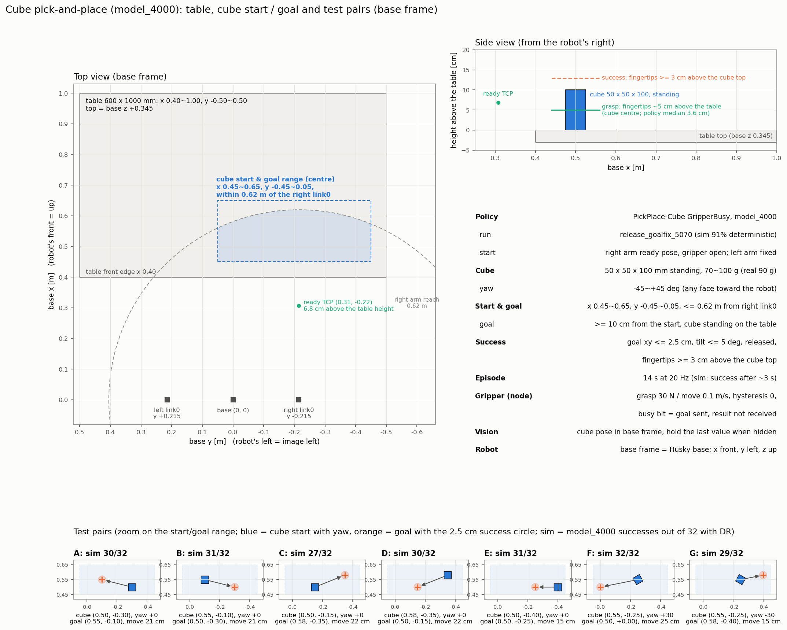
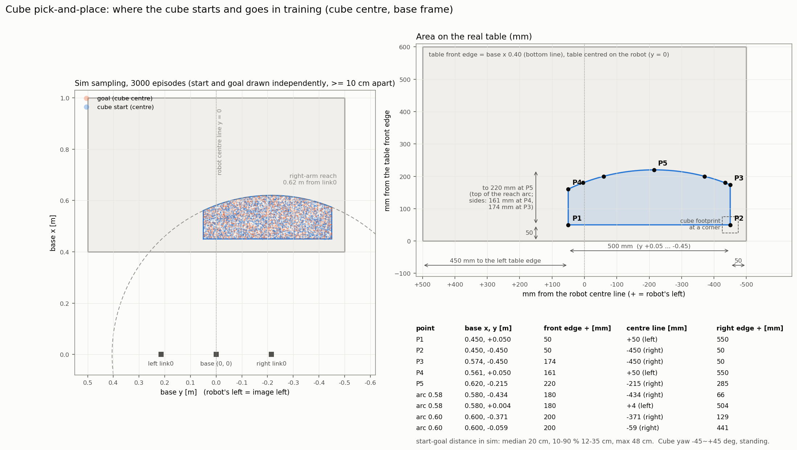

# dual FR3 큐브 pick-and-place 실로봇 실험 순서 (2026-11-09)

오른손(Franka hand + UMI 팁)으로 책상 위에 세워 둔 큐브를 위에서 집는다. 목표 위치에 세워 놓고, 손을 뗀 뒤 위로 올린다.
왼팔은 ready 자세로 서 있다(정책이 움직이지 않음).

노드 계약과 export는 [../fr3_husky_nn_policy/README.md](../fr3_husky_nn_policy/README.md)의 "PickPlaceCube" 절에 있다.
학습 기록은 dual_fr3_lab `docs/dual_fr3_pick_place_cube.md`에 있다.





그림 다시 그리기 (dual_fr3_lab):

```bash
python scripts/tools/draw_pick_place_layout.py --out ~/etri_ws/src/fr3_husky_etri/docs/figures/pick_place_cube_layout.png
python scripts/tools/draw_pick_place_area.py --out ~/etri_ws/src/fr3_husky_etri/docs/figures/pick_place_cube_area.png
```

## 정책 (`fr3_husky_nn_policy/models/`)

| 파일 | 학습 | sim 결과 (결정적, DR 켬, 256 env) |
|---|---|---|
| `dual_fr3_pick_place_cube_gripper_busy_model4000.npz` (**기본**) | 5070 `release_goalfix_5070` model_4000 | 234~235/256 (약 92 %), 첫 성공 중앙 2.9 s. 손가락-책상 접촉 > 1 N은 139/256 env, 최대 62 N |
| `dual_fr3_pick_place_cube_critic_plus_model4749.npz` | 4090 `release_goalfix_critic_plus_4090` model_4749 | 188/256 (73 %), 첫 성공 중앙 2.7 s. 손가락-책상 접촉 53/256 env, 최대 67 N. 쥘 때 손가락 끝 중앙이 책상 위 3.9 cm (목표 5 cm) |

- 두 모델은 actor가 같다(관측 37 → 행동 8, tanh). CriticPlus는 critic 입력만 더 받는다. 그래서 같은 노드에서 `model_path`만 바꿔 돌린다.
- 각 npz 옆의 같은 이름 `.yaml`에 출처 체크포인트의 sha256, 관측·행동 계약, 학습 범위, DR, sim 결과가 있다.
- **model_4000부터 시험한다.** 성공률이 훨씬 높다. 4749는 책상에 닿는 횟수는 적지만, 닿을 때 최대 힘은 비슷하다.
- sim과 대조했다(model_4000, 32 env × 279 step). 노드 코드로 만든 관측과 sim 관측의 차이는 최대 2e-6이다(FK TCP 포함). npz와 torch 정책의 행동 차이는 최대 5e-5다.

### 관측과 행동

| 번호 | 관측 | 실로봇 출처 |
|---|---|---|
| 0~6 | 오른팔 q − ready | `/dual_fr3/joint_states` |
| 7 | `right_fr3_finger_joint1` (절대값, sim은 0.25~0.38 s마다 갱신) | `/right_franka_gripper/joint_states` |
| 8~14 | 오른팔 qdot | `/dual_fr3/joint_states` |
| 15~17 | 큐브 중심 (base) | 비전 `/cube_tf` (+ `object_position_offset_m`) |
| 18~21 | 큐브 quat xyzw. z축 90° 대칭을 접어 yaw ±45°, w ≥ 0 | 비전 |
| 22~24 | 큐브 − TCP (base) | 비전 − FK TCP (link7 + 0.2844 m) |
| 25~27 | 목표 큐브 중심 (z 0.395 고정) | `goal_xy_m` |
| 28~35 | 이전 행동 8 | 노드 |
| 36 | 그리퍼 진행 중 (goal을 보낸 뒤 result까지 1) | 노드 |

- 팔: q_target = q + clip(0.1·a, ±0.1 rad)을 학습 관절 한계로 자른다. 20 Hz, Isaac PD(`isaac_relative_control`).
- 그리퍼: a[7] < 0이면 닫기(grasp, 30 N, 0.1 m/s), 0 이상이면 열기(Move 0.08 m)다. 히스테리시스는 없다.
  - 한 번에 하나만 보낸다. 진행 중에 바뀐 요청은 result 뒤에 마지막 것만 보낸다.
  - sim 그리퍼도 같게 학습했다: 명령 지연 0.45~0.9 s, 0.1 m/s, 끝 확인 0.3~0.4 s(11-08 실측 반영).
- 큐브 마커가 손에 가려 끊겨도 세션은 계속하고 마지막 pose를 쓴다(sim도 0~3 step 지연과 끊김 유지로 학습). 작업 영역 밖 pose는 버린다.

### 큐브 lift(Sim2Real-100Hz)와 같은 것, 다른 것

| | 큐브 lift | pick-and-place |
|---|---|---|
| 손끝 | 기본 Franka 팁 | **UMI 팁** (TCP가 link7에서 0.2844 m) |
| 큐브·비전 | 50×50×100 mm, `/cube_tf` | 같음 |
| 큐브 방향 | 관측 안 함, yaw 0만 | **quat 관측**, yaw ±45° 학습 (90° 대칭이라 아무 방향이나 됨) |
| 목표 | 공중 xyz | 책상 위 xy (z는 선 큐브 높이 0.395) |
| 그리퍼 | 히스테리시스 0.1 | 0, 진행 중 비트 관측 |
| 끝 | 8 s | 성공이 0.5 s 유지되면 정지, 아니면 14 s |
| 비전 끊김 | 0.2 s 넘으면 세션 정지 | 마지막 pose 유지 |

## 배치

캐비닛 75 cm 책상을 쓰고, 수납장은 치운다.

| | 값 (base = 두 link0 가운데의 팔 장착면, m) |
|---|---|
| 책상 윗면 | **base z 0.345** (실물 바닥에서 약 0.725 m, [dual_fr3_cabinet_book_layout_75cm.md](dual_fr3_cabinet_book_layout_75cm.md)) |
| 책상 (600 × 1000 mm) | **앞 모서리 x 0.40**, x 0.40~1.00, y −0.50~+0.50 (가운데 y 0) |
| 오른팔 link0 | (0, −0.215, 0), yaw −30° |
| 큐브 시작·목표 영역 | x 0.45~0.65, y −0.45~+0.05, 오른팔 link0 축에서 0.62 m 안 |
| 시작 ↔ 목표 거리 | 0.10 m 이상 |
| 큐브 | 50 × 50 × 100 mm, 세워서. 실물 90 g (학습 0.07~0.10 kg, 정지 마찰 0.4~1.2) |

- y > 0.05는 왼팔 ready 자세의 손(y +0.175~+0.255, z 0.53)이 막는다. 학습하지 않았다.
- 책상 높이 DR은 ±1 cm였다. 노드 시작 검사는 큐브 중심 z 0.395 ± 0.03까지 받지만, **±1 cm 안으로 맞춘다.**

## 실물에서 먼저 확인할 것 (첫 command 전에 한 번)

| 항목 | sim 값 | 확인 방법 | 다르면 |
|---|---|---|---|
| UMI 팁으로 큐브를 30 N으로 쥐었을 때 `right_fr3_finger_joint1` | 0.0234 | 큐브를 손으로 손가락 사이에 두고 grasp → `ros2 topic echo /right_franka_gripper/joint_states` | 관측 7이 달라진다. 노드에서 보정하거나 재학습 |
| 다 열었을 때 `right_fr3_finger_joint1` | 0.04 | Move 0.08 뒤 같은 토픽 | 위와 같음 |
| link7 → 손가락 끝 중앙 TCP | z 0.2844 m | 자로 잼 (캐비닛 FK 노드도 같은 값) | `tcp_offset_position_m` |
| 책상 윗면 높이 | base z 0.345 | 큐브를 세워 두고 `/cube_tf` z가 **0.395 ± 0.01**인지 | 책상 높이. 비전이 일정하게 높으면 `object_position_offset_m` |
| 오른팔 장착 | (0, −0.215, 0), yaw −30° | 첫 shadow 세션 `metadata.json`의 `right_link0_mount_base` | TF/URDF 확인. 노드는 FK와 TF의 link7만 비교하고, 장착 위치 자체는 sim과 비교하지 않는다 |
| ready 자세 | 학습 ±0.05 rad | `move_to_joint` 뒤 그대로 | 노드는 0.2 rad까지 받지만 ±0.05 안으로 맞춘다 |

## 시험 쌍

model_4000의 sim 결과(쌍마다 32 env, 결정적, DR 켬)다. 처음에는 **A**부터 한다.

| 쌍 | 큐브 시작 (x, y, yaw) | 목표 `goal_xy_m` | 거리 | sim 성공 |
|---|---|---|---|---|
| A | (0.50, −0.30, 0°) | [0.55, −0.10] | 21 cm | 30/32 |
| B | (0.55, −0.10, 0°) | [0.50, −0.30] | 21 cm | 31/32 |
| C | (0.50, −0.15, 0°) | [0.58, −0.35] | 22 cm | 27/32 |
| D | (0.58, −0.35, 0°) | [0.50, −0.15] | 22 cm | 30/32 |
| E | (0.50, −0.40, 0°) | [0.50, −0.25] | 15 cm | 31/32 |
| F | (0.55, −0.25, +30°) | [0.50, 0.00] | 25 cm | 32/32 |
| G | (0.55, −0.25, −30°) | [0.58, −0.40] | 15 cm | 29/32 |

- yaw는 큐브 면이 base x축과 이루는 각이다. +는 위에서 보아 반시계다.
- 왼쪽(y 큰 쪽)에서 오른쪽으로 길게(약 33 cm) 옮기는 쌍은 sim 84 %로 떨어진다. 위 쌍이 된 뒤에 시험한다.

## 0. 준비 (한 번)

1. 이 PC의 변경을 로봇 PC 작업공간(`~/jw_ws/src/fr3_husky`)에 받는다(git pull).
2. 빌드한다.
   ```bash
   cd ~/jw_ws && colcon build --symlink-install --packages-select fr3_husky_nn_policy && source install/setup.bash
   ```
3. 손끝이 **UMI 팁**인지 확인한다(큐브 lift 때 기본 팁으로 바꿨다면 다시 바꾼다).
4. 수납장을 치우고 책상만 둔다. 앞 모서리 x 0.40, 윗면 base z 0.345.

**모든 터미널 공통**

```bash
source ~/jw_ws/install/setup.bash
cd ~/jw_ws/src/fr3_husky
```

## 1. 터미널 1: 제어기 + 정책 노드 (shadow)

```bash
ros2 launch fr3_husky_nn_policy dual_fr3_pick_place_cube_policy.launch.py shadow_mode:=true launch_move_group:=true \
  goal_xy_m:="[0.55, -0.10]"
```

- 기본 모델은 model_4000이다. 4749는 `model_path`만 바꾼다.
  ```bash
  ros2 launch fr3_husky_nn_policy dual_fr3_pick_place_cube_policy.launch.py shadow_mode:=true launch_move_group:=true \
    goal_xy_m:="[0.55, -0.10]" \
    model_path:=$PWD/fr3_husky_nn_policy/models/dual_fr3_pick_place_cube_critic_plus_model4749.npz
  ```
- 그리퍼 action server(`load_gripper`)는 launch가 항상 켠다. 비전 토픽 기본은 `object_pose_topic:=/cube_tf`다.
- 로그 확인: `Loaded ...model4000.npz (37->8 ...)`, `mode=SHADOW`.
- RViz (`~/goal_marker` 목표, `~/cube_marker` 정책이 보는 큐브, `~/range_markers` 학습 영역): 목표가 범위 밖이면 빨강이다.

## 2. 터미널 2: 비전

큐브 lift와 같은 비전 노드(`/cube_tf`)를 띄운다.

```bash
ros2 topic hz /cube_tf
ros2 topic echo /cube_tf --once      # 세운 큐브면 base z ≈ 0.395
```

- RViz의 정책 큐브가 실제 큐브와 겹쳐야 한다.
- z가 0.445 근처면 큐브 중심이 아니라 마커 윗면 pose를 내는 것이다. 비전을 고치거나 `object_position_offset_m:="[0.0, 0.0, -0.05]"`를 준다.

## 3. 터미널 3: ready 자세, 그리퍼 열기, 큐브 놓기

```bash
ros2 run fr3_husky_task_manager move_to_joint        # 기본값이 학습 ready 자세 (오른팔 0.5236 -0.7854 0 -2.3562 0 1.5708 0.7854)
ros2 action send_goal /right_franka_gripper/move franka_msgs/action/Move "{width: 0.08, speed: 0.1}"
```

큐브를 시험 쌍의 시작 위치에 세운다.

## 4. 터미널 4: 목표 → shadow 시작

```bash
ros2 param set /ppo_pickplace_cube_policy_node goal_xy_m "[0.55, -0.10]"     # IDLE일 때만, 범위 밖이면 거부
ros2 service call /ppo_pickplace_cube_policy_node/start_policy std_srvs/srv/Trigger {}
ros2 service call /ppo_pickplace_cube_policy_node/stop_policy std_srvs/srv/Trigger {}   # 멈출 때 (따로 보낸다)
```

- shadow에서는 명령을 보내지 않는다. 14 s 동안 추론과 로그만 남기고, 그리퍼는 `would_send` 이벤트로만 남는다.
- 로봇이 움직이지 않으니 정책은 매 step 같은 관측을 본다. 확인할 것:
  - 첫 몇 step의 관측(큐브 위치·quat, 큐브 − TCP, 목표)이 실제 배치와 맞는지
  - 행동이 한쪽으로 꽉 차(±1) 있지 않은지
  - `metadata.json`의 `right_link0_mount_base`
- 터미널 1에 `FK vs TF right link7: x.xx mm`가 나온다(3 mm 넘으면 거부).

시작이 거부되면 메시지대로 고친다.

| 메시지 | 고칠 것 |
|---|---|
| `cube (...) outside the trained x (0.45, 0.65), y (-0.45, 0.05)` / `... m from the right link0 axis` | 큐브 위치 (±1 cm까지 받음) |
| `cube centre z ... is not a standing cube` | 책상 높이, 또는 비전이 마커 pose를 냄(0.445 근처) |
| `cube tilt ... deg (> 20): stand it upright` | 큐브를 세운다 |
| `goal is ... m from the cube (trained >= 0.1 m)` | 목표나 큐브를 옮긴다 |
| `right arm is not at the training ready pose` | `move_to_joint` |
| `open the right gripper first` | 3번의 Move |
| `waiting for the cube pose` / `cube pose is stale (marker not visible?)` | 비전 노드, 마커 가림 |
| `FK link7 is ... mm from TF link7` | URDF·TF 확인 |
| `franka gripper grasp/move action servers are not ready` | 그리퍼 노드가 떴는지 |

## 5. 명령 모드

터미널 1을 끄고 `shadow_mode:=false`로 다시 띄운다. **비상정지를 손에 둔다.**

```bash
ros2 launch fr3_husky_nn_policy dual_fr3_pick_place_cube_policy.launch.py shadow_mode:=false launch_move_group:=true \
  goal_xy_m:="[0.55, -0.10]"
```

시도마다 3번(ready, 그리퍼 열기, 큐브 세우기) → 4번(목표, start)을 반복한다.

- **끝나는 때**
  - 성공이 0.5 s 이어지면 노드가 컨트롤러 goal을 멈추고 팔은 그 자세로 선다(`stop_on_success_s`, 0이면 끔).
  - 그 밖에는 14 s, `stop_policy`, joint state 끊김, 추론 실패, 그리퍼 goal 거부일 때 멈춘다.
  - 성공 판정은 sim 성공 단계와 같다: 큐브-목표 xy 2.5 cm 안, 손가락 끝이 큐브 윗면보다 3 cm 위, 큐브 pose가 0.2 s 안에 들어온 값.
- **성공 뒤 그리퍼 재닫기**: 두 모델 모두 큐브를 놓은 뒤 공중에서 그리퍼를 다시 닫는다.
  - model_4000은 성공 약 0.1 s 뒤, 4749는 성공한 순간에 이미 닫기 요청 중이다.
  - sim에서는 손이 큐브 위에 떠 있어 성공이 14 s까지 유지됐다. 그래서 그리퍼 열림(`released`)은 성공 조건에서 뺐고, 값만 남긴다.
  - 노드가 멈춰도 그리퍼는 그 상태로 둔다. 다음 시도 전에 3번의 Move로 연다.
- **속도**: 관절이 sim처럼 최대 약 2 rad/s로 움직인다(행동이 한 step에 0.1 rad까지). Isaac PD 모드에서는 `joint_velocity_scale`·`max_actuator_step_rad`가 속도를 바꾸지 않는다.
- **낮게 쥐기**: 두 모델 모두 책상 가까이 내려가 쥔다(4749 손가락 끝 중앙이 책상 위 3.9 cm, 학습 목표 5 cm, 하한 3 cm). sim에서도 손가락이 책상에 닿는 env가 있었다(최대 60 N대). 처음 몇 번은 손가락과 책상 사이를 지켜본다.
- 목표 바꾸기: 세션이 끝난 IDLE에서 `ros2 param set ... goal_xy_m`. 다음 start부터 적용된다.

## 로그

세션마다 `fr3_husky_nn_policy/data/dual_fr3_pick_place_cube/<시각>/`에 남는다(`log_root`로 바꿀 수 있다).

| 파일 | 내용 |
|---|---|
| `metadata.json` | 모델, 파라미터, 큐브 시작 pose, 목표, `right_link0_mount_base`, 끝난 이유, `final_cube_vs_goal` |
| `trace.csv` | 20 Hz 한 줄씩: tick 주기, 관절·큐브 pose 나이, 관측 37, 행동 8, 오른팔 목표 7, 그리퍼 명령과 손가락 폭 |
| `gripper_events.csv` | 그리퍼 goal마다 `send`, `accepted`, `result` (shadow는 `would_send`) |

결과는 `experi_result/dual_fr3_pick_place_cube/results.csv`에 세션당 한 줄 남는다(`result_root`로 바꿀 수 있다).
- 열: `session`, `model`, `mode`, `end_reason`, `duration_s`, 시작·목표·최종 xyz, `error_x/y/z`, `error_xy_norm`, `tilt_deg`, `cube_yaw_deg`, `hand_clear_m`, `released`, `success`, `success_with_tilt`, `first_success_s`, `finger_width_m`, `cube_pose_age_ms`, `cube_pose_rejected`, `clamped_steps`, `log_dir`
- `success`는 기울기를 보지 않는다. 비전이 선 큐브도 3~4° 기울었다고 읽기 때문이다. 학습 기준(5°)까지 넣은 값은 `success_with_tilt`다.
- 터미널 1에도 `Success at x.xx s`, `Final cube vs goal: ...`, `Session result appended to ...`가 나온다.

`ros2 run fr3_husky_nn_policy liftcube_log_summary <run_dir>`도 돌아간다. 다만 믿을 수 있는 줄은 일부뿐이다.
- 맞는 줄: `tick`, `cube age`, `width`, 그리퍼 표(send → accepted → motion → result)
- 틀린 줄: `cube z`, `cube noise`, `lift start`. 큐브 lift의 관측 번호(큐브 z = obs_20)를 읽는데, pick-place에서 obs_20은 큐브 quat z다. 큐브 위치는 `results.csv`나 `trace.csv`의 `obs_15~17`을 본다.

## 결과 기록

| 날짜 | 모델 | 쌍 | 시도 | success | xy 오차 (cm) | 첫 성공 (s) | 메모 (미끄럼, 책상 닿음, 재닫기 등) |
|---|---|---|---|---|---|---|---|
| | model_4000 | A | 1 | | | | |

## 다음: 책상을 당긴 배치 (Near, 학습 중)

dual_fr3_lab `Isaac-PickPlace-Cube-DualFR3-UMI-GripperBusy-Near-v0`. 책상 앞 모서리를 x 0.30으로 10 cm 당기고, 큐브 시작·목표를 x 0.35~0.65로 넓혔다(목표 넓이 약 1.65배).
- model_4000에서 이어 학습 중이다(11-09 12:44 시작, 5070). model_4000을 이 배치에 그대로 쓰면 sim 71.5 %다.
- 이 모델을 배포할 때는 노드의 학습 범위 상수(`pickplace_cube_core.py`의 `CUBE_X`)를 0.35~0.65로 바꿔야 한다. 지금 노드는 x 0.45 앞의 큐브와 목표를 거부한다.
